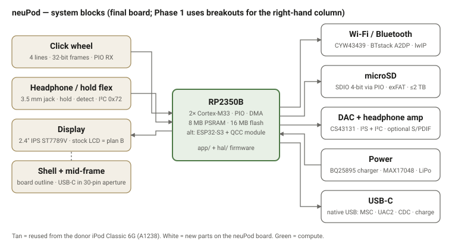
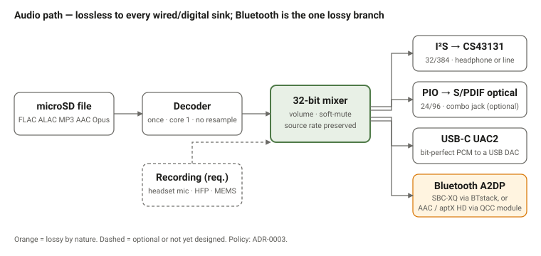
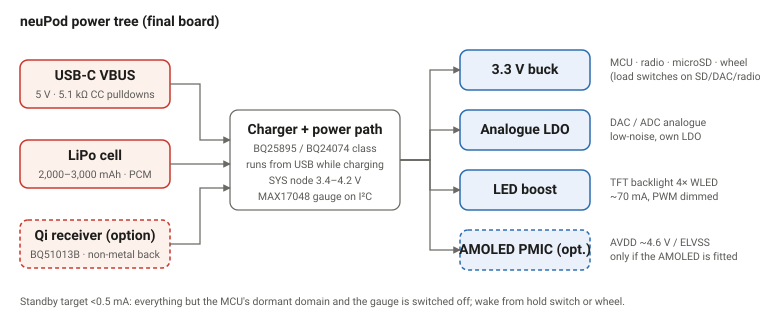

# Design

Exported from the neuPod design doc (Design tab, 27 Oct – 1 Nov 2026). Companion to the
[Requirements](requirements.md). This page records the engineering decisions: architecture, pin
budget, interfaces to the reused iPod parts, and what remains to be verified. Phase 1 target is a
Raspberry Pi Pico 2 W on the bench driving the donor's click wheel, LCD and headphone flex.

Decisions with lasting consequences are also recorded as [ADRs](adr/index.md).

## Goal and scope

Build the firmware and the replacement logic board in two phases:

1. **Phase 1 — bench testbed.** A Pico 2 W on a breadboard with off-the-shelf breakouts (display,
   microSD, I²S DAC, fuel gauge, haptic driver) and, once measured and broken out, the donor's own
   click wheel and headphone/hold flex. Every driver written here must port unchanged to the final
   board through the HAL.
2. **Phase 2 — custom board.** An RP2350B (or ESP32-S3) board to the mid-frame's outline, with the
   final display, DAC, charger and radio.

## Target hardware

| Block | Phase 1 (bench) | Final board |
| --- | --- | --- |
| Compute | Pico 2 W (RP2350A, 26 GPIO, 4 MB flash, no PSRAM) | RP2350B + 8 MB APS6404L PSRAM (QSPI CS1) + 16 MB W25Q128 flash |
| Radio | CYW43439 on Pico 2 W via internal SPI (uses GP23/24/25/29 — not available to us) | Not a bare CYW43439; RM2 module or ESP32 — open ([ADR-0007](adr/0007-bluetooth-audio-path.md)) |
| Display | Adafruit 2.0" 320×240 IPS TFT (ST7789) on SPI1, landscape — see [wiring](wiring-phase1.md) | ER-TFT024IPS-3 (or RM690B0 AMOLED), 8080-16 via PIO if pins allow |
| Storage | microSD, SDIO 4-bit via PIO on GP2–7 ([ADR-0006](adr/0006-storage-microsd-sdio.md); SPI mode is the fallback) | SDIO 4-bit |
| Audio | Pimoroni Pico Audio Pack: PCM5100A + PAM8908 (I²S on GP9–11, GP22 = XSMT, active low) | ES8311 / ES8388 / PCM5102A, MCLK provided ([ADR-0012](adr/0012-audio-codec-final-board.md)) |
| Input | Donor click wheel via FPC breakout; hold switch from headphone flex | Same |
| Power | USB from the Pico, Micro-Lipo (MCP73831) + MAX17048 for battery tests | BQ25895 (0x6A) + fuel gauge, USB-C; SD VDD load switch |
| USB | Pico's native USB (TinyUSB: MSC + CDC) | Native USB on USB-C |

## Compute options

Available: GP0–GP22 and GP26–GP28 = **26 GPIO** (GP23/24/25/29 are consumed by the wireless module). GP26–28 are the only ADC-capable pins.

| Interface | Signals | Pins | Notes |
| --- | --- | --- | --- |
| LCD (SPI, 4-wire) | SCK, MOSI, CS, DC, RST, backlight PWM | 6 | MISO omitted; ~19 fps full-frame at 62.5 MHz SPI, partial updates for UI. 8-bit 8080 (12–13 pins) does **not** fit on the 2 W alongside everything else |
| microSD (SDIO 4-bit, PIO) | CLK, CMD, D0–D3 | 6 | Fallback: SPI mode on SPI0 with its own CS = 4 pins (D1/D2 become CD/unused) |
| I²S audio | BCLK, LRCLK, DOUT | 3 | PIO I²S; the PCM5100A needs no MCLK. Final board adds MCLK from `clk_gpout` (+1) |
| I²C (shared bus) | SDA, SCL | 2 | DAC control, fuel gauge, charger, haptic driver, future touch |
| Click wheel | Serial data, clock, enable/power, (optional extra) | 3–4 | Pinout and protocol to be confirmed from Rockbox `s5l8702/ipod6g` wheel driver and a logic-analyser capture of the stock board |
| Headphone/hold flex | Hold switch, headphone detect | 2 | Remote/accessory lines (2) left unconnected in Phase 1 |
| Battery / power | Thermistor (ADC), charger INT or PGOOD | 2 | Thermistor on GP26–28 |
| Haptic (optional) | Enable/trigger | 1 | DRV2605L on I²C |
| Debug UART | TX, RX | 2 | Optional — USB CDC can replace it once USB is up |
| **Total** |  | **27–28 with everything** | **24** with SD in SPI mode and no UART — fits. SDIO + no haptic + no UART = 25 — fits |

**Conclusion:** the Pico 2 W works for Phase 1 if the LCD is SPI and either SD is SPI or haptics/UART are dropped. There is no headroom for a parallel LCD bus. The final board (RP2350B, 48 GPIO) lifts this: 8080-16 LCD (20 pins) + SDIO (6) + I²S with MCLK (4) + I²C (2) + wheel (4) + flex (4) + power (3) + haptic (1) + radio SPI (5 if CYW43439) ≈ 49 — so even the B variant is tight with a 16-bit bus; 8080-8 (12 pins) is the likely final choice.

The application layer (LVGL UI, FatFs, codecs, library logic) is portable C. What is not portable is the radio and USB stack, and two requirements constrain the chip: classic Bluetooth A2DP (AirPods, most headphones) and USB mass storage.

| Chip | A2DP source | Native USB device | Verdict |
| --- | --- | --- | --- |
| RP2350 + CYW43439 | Yes (BTstack; Sprout) | Yes | Current plan; 150 MHz M33 + PIO is enough |
| ESP32 (original, WROVER-E) | Yes (ESP-IDF / ESP-ADF) | No | Strong audio stack, 240 MHz, PSRAM; needs Wi-Fi-only transfer or a USB-SD bridge/mux |
| ESP32-S3 | No (BLE only) | Yes | Best MCU on paper; needs an external A2DP transmitter |
| ESP32-P4 + C6 | No | Yes | Overkill; C6 is BLE only |
| STM32H7 / nRF / i.MX RT | No radio | Yes | External Wi-Fi/BT module either way |

Escape hatch: a dedicated Bluetooth audio transmitter IC/module on I²S (Qualcomm QCC30xx/QCC51xx, Microchip BM83, BK3266-class) removes the A2DP constraint, adds aptX/LDAC, and makes the ESP32-S3 the strongest alternative. Decision: RP2350 + CYW43439 for Phase 1; keep the radio behind an interface so the ESP32-S3 + external A2DP route stays open for the final board.

## Connectivity

**Effect of an external Bluetooth audio module (Qualcomm QCC3008/3040/5125, Microchip BM83):** A2DP and codec negotiation (AAC, aptX HD, some LDAC) move off the MCU; it streams I²S and controls the module over UART. That removes the RP2350's main advantage (BTstack A2DP) and makes the ESP32-S3 the better host (240 MHz, octal PSRAM, native USB, hardware QSPI for the AMOLED, ESP-ADF).

|  | A: RP2350 + CYW43439 | B: ESP32-S3 + QCC module | C: RP2350 + QCC module |
| --- | --- | --- | --- |
| BT codecs | SBC / SBC-XQ | AAC, aptX HD, (LDAC) | AAC, aptX HD, (LDAC) |
| Wi-Fi | CYW43439 | On-chip | CYW43439 |
| AMOLED QSPI | PIO, reduced fps | Native peripheral | PIO, reduced fps |
| Extra parts | None | QCC module + antenna | QCC module + CYW43439 (two radios) |
| Firmware | Pico SDK + BTstack | ESP-IDF + ESP-ADF | Pico SDK, no BT stack |
| Power | Lowest | Moderate | Moderate |

Bench test to decide: Pico 2 W running BTstack SBC-XQ vs a QCC3008 transmitter board (~£8, AliExpress/eBay) or BM83 eval module fed from the Audio Pack, both paired to AirPods.

## Storage

microSD over **SDIO 4-bit on PIO** (GP2–GP7 on the testbed), FatFs with exFAT, cards up to 2 TB.
SPI mode is the fallback (CLK = SCK, CMD = MOSI, DAT0 = MISO, DAT3 = CS), which frees two GPIOs
for the hold switch and headphone detect on the Pico 2 W. The card and the display sit on
different buses so a frame refresh and an audio-buffer fill can run concurrently on DMA. See
[Requirements → Storage](requirements.md#storage).

## Display

Phase 1 uses the Adafruit 2.0" 320×240 IPS TFT (ST7789) on SPI1 in landscape — see
[ADR-0002](adr/0002-display-st7789-spi-phase1.md) and the [wiring page](wiring-phase1.md). The
final-board candidates (EastRising ER-TFT024IPS-3 and the 2.4" RM690B0 AMOLED) are in
[Requirements → Display](requirements.md#display).

### Stock LCD (plan B only)

| Item | Value | Source |
| --- | --- | --- |
| Bus | 8080-series parallel, 18-bit data bus physically (D0–D17) plus CS, RS/DC, WR, RD, RESET, TE (tearing-effect) and a 2-bit panel ID | `lcd-s5l8702.c` |
| Pixel transfers | RGB565, one transfer per pixel, on D[17:10] + D[8:1] ("Type II" 16-bit wiring — D0 and D9 unused for data) | `lcd-s5l8702.c` |
| Panel types | Four supplier variants, read from GPIO 6.4/6.5 at boot. Types 0 and 1: 8-bit MIPI-DCS command set (ILI9340-like) on D[8:1] — `0x2A/0x2B` window, `0x2C` memory write, `0x11/0x29` wake, `0x28/0x10` sleep, `0x3A=0x06` 18-bit pixel format, `0x35` TE on. Types 2 and 3: 16-bit register set (ILI9320/9326-like) — `0x200/0x201` GRAM address, `0x202` write, `0x210–0x213` window; full init and gamma tables are in `lcd-6g.c` | `lcd-6g.c` |
| Timing | Rockbox sets `LCD_PHTIME` 0x11 for normal, 0x33 for ID reads — i.e. a slow bus is tolerated; PIO can meet it easily | `lcd-s5l8702.c` |
| Backlight | White-LED string driven by the PMU's boost LED driver (regs 0x28 brightness, 0x29 on/off, 0x2A OCP 500 mA, 0x2B dim step). **Needs a boost LED driver on our board**; string voltage to measure | `backlight-6g.c` |
| Pin cost | ≥ 22 GPIO — rules it out on the Pico 2 W; viable only on the RP2350B board with an 8-bit command path and PIO | — |
| Connector | FPC pin count/pitch **to measure**; ID pins must be read to pick the init sequence | measure |

## Audio

### Stock audio codec (reference for the DAC choice)

Stock part is a Cirrus CS42L55 at I²C address 0x94 (8-bit), I²S from the SoC, reset on GPIO 3.3, master clock from the SoC (`CLKCON3`), analogue rail "Vcodec" 1.8 V from PMU LDO3 (2.4 V when recording). The CS43131 (its DAC-only successor) was the original plan; it is dropped for stock reasons, see [ADR-0012](adr/0012-audio-codec-final-board.md).

The audio quality policy, the Bluetooth codec table and the recording requirement are in
[Requirements → Audio](requirements.md#audio) and [ADR-0003](adr/0003-audio-quality-policy.md).

## Power and battery

### Stock power, battery and charging (reference)

| Item | Stock | Our equivalent |
| --- | --- | --- |
| PMU | NXP PCF50635 ("D1671"): LDOs, backlight boost, ADC, hold/EXTON inputs, standby/wake | Discrete: buck + LDOs, LED boost, fuel gauge |
| Charger | LTC4066 with HPWR (100/500 mA), SUSP, CLPROG (current doubling) GPIOs; battery charge limited to ~330–340 mA by RPROG | BQ25895/BQ24074 with power-path; set charge current for the chosen cell |
| Battery sense | PMU ADC `BATSNS`, 10-bit, averaged | Fuel gauge (BQ27441/MAX17048) or ADC divider |
| Battery connector | 3-pin (cell+, thermistor, cell−) **to measure** pitch | Same, or JST for a raw cell |
| USB | D+/D− routed to PMU ADC to detect charger type; USB insert on GPIO 12.3 | Native USB; CC pulldowns |
| FireWire/dock power | PMU EXTON input | Not needed |
| Storage | 1.8" ATA over 40-pin ZIF, power-gated via PMU | microSD |
| Dock accessory serial | UART on the 30-pin (iPod Accessory Protocol) + accessory-ID resistor via PMU ADC | Dropped (USB-C replaces the dock) |

### Phase 1 power rails

- **Bench power:** Pico's USB-C (VBUS 5 V) → VSYS → on-board buck-boost → 3V3. Budget on 3V3: SD ~100 mA peak, Audio Pack ~50 mA, I²C boards <5 mA, CYW43439 up to ~300 mA bursts. Keep the TFT on VSYS.
- **Battery test:** LiPo → MAX17048 → Micro-Lipo charger (charges from the charger's own USB-C) → Schottky → VSYS. With both USBs plugged in, the Pico runs from whichever is higher; the diode keeps them apart.
- All grounds common; star them at the Pico GND pins.

## Reused parts and mechanical

Source: Rockbox git, `firmware/target/arm/s5l8702/` (`lcd-s5l8702.c`, `ipod6g/lcd-6g.c`, `ipod/button-clickwheel.c`, `ipod6g/pmu-6g.c`, `backlight-6g.c`, `cscodec-6g.c`, `mikey-6g.c`, `power-6g.c`, `adc-6g.c`), plus the community 5G click-wheel teardown for the physical layer. What follows is what our board must replicate for each reused part; items marked **measure** still need the donor.

### Click wheel

The wheel is a self-contained touch controller (a Cypress PSoC on the 5G; same protocol family on the 6G) that streams 32-bit frames to the host. The S5L8702 uses a dedicated "WHEEL" peripheral on four port-14 pins (`PCON14` bits 8–23, alt-function 2); on our board this is a PIO state machine or a GPIO interrupt.

| Item | Value | Source |
| --- | --- | --- |
| Lines to the host | CLK (wheel → host, open-drain, ~53 kHz), SDO (wheel → host, open-drain), SDI (host → wheel), plus a 4th line the SoC configures with the other three — likely WAKE or enable. 18 kΩ pull-ups on the 5G flex | 5G teardown; Rockbox `PCON14` 4-pin config |
| Supply | Wheel has its own LDO (3.0 V out); fed from the iPod system rail (3.3–4.2 V). 3.3 V from our board is fine | 5G teardown |
| Frame | 32 bits, LSB first, clocked by the wheel. Valid frame: `(status & 0x800000FF) == 0x8000001A`. Bits 8–12 = Select, Right, Left, Play, Menu (1 = pressed). Bits 16–22 = finger position 0–95 (3.75°/count, clockwise, 0 at Menu). Bit 30 = finger on wheel. Bit 31 always set | Rockbox `button-clickwheel.c` |
| Host → wheel | On init and after Hold is released the host sends `0x8000023A`; the wheel replies with a `0x8000023A`-type frame carrying button state in bits 16–20. That is the only host transmission Rockbox makes | Rockbox `s5l_clickwheel_init()` |
| Hold behaviour | On Hold, Rockbox stops the wheel controller and drives the 4 lines as GPIO (low); on release it re-inits. We should power-gate or idle the wheel the same way for battery life | Rockbox `button_read_device()` |
| Scroll handling | 96 counts/rev; Rockbox uses 4 counts per list step, velocity-based acceleration, 150 ms "untouched" debounce, 250 ms repeat timeout. Reuse these constants | Rockbox |
| Connector | 5G: 13-pin 0.3 mm FPC (DDK FF12-13A-R11AL-3H). **6G Classic: pin count and pitch to measure** on the donor | 5G teardown; measure |
| Phase 1 plan | Breakout the FPC; probe CLK/SDO on the stock board with a logic analyser to confirm which 6G pins are CLK, SDO, SDI and the 4th line; then PIO receiver on the Pico | — |

### Headphone / hold-switch flex

| Item | Value | Source |
| --- | --- | --- |
| Hold switch | Not on a SoC GPIO: it goes to the PMU's GPIO2 (PCF50635 `GPIOSTAT`) with an interrupt. On our board: plain GPIO with pull-up, active-low = locked | `pmu-6g.c`, `button_hold()` |
| Headphone detect | SoC GPIO 10.6, high when a plug is inserted | `headphones_inserted()` |
| Inline remote / mic ("Mikey") | The flex carries an **I²C-controlled chip at address 0x72** that handles mic bias, Apple inline-remote volume/centre buttons and accessory ID. Needs I²C (shared bus) + mic bias from the codec rail. Register map is in `mikey-6g.c` (reg0 mode 0x2F = remote mode; reg4 centre button; reg5 vol ± events). Optional for us, but it means the flex has SDA/SCL on it | `mikey-6g.c` |
| Audio lines | L, R, GND from the codec's headphone amp; mic line to Mikey | — |
| Connector | ZIF; pin count/pitch **to measure** | measure |

### What this means for the Phase 1 harness

1. Click wheel: 4 lines + 3.3 V + GND. Pull-ups to 3.3 V on CLK/SDO (18 kΩ). PIO clocked-serial receiver; one GPIO for the host init packet.
2. Hold + headphone detect: two GPIO inputs with pull-ups.
3. I²C bus: Mikey (0x72) on the headphone flex if we want the inline remote; CS43131 and the fuel gauge later.
4. Stock LCD: skip on the Pico 2 W. Use the Adafruit 2.0" ST7789 over SPI1 (the ER-TFT024IPS-3 is the final-board candidate).
5. No change to the earlier pin budget except the wheel is confirmed as 4 lines, not 3.

## Firmware

### Development environments

| Layer | Environment | What runs there |
| --- | --- | --- |
| Application (UI, library index, playback logic, codecs, FatFs) | Host-native build (`PICO_PLATFORM=host`, LVGL SDL backend, FatFs on a disk-image file, SDL audio) | Day-to-day development and unit tests; wheel mapped to mouse/keys |
| Drivers (ST7789 SPI/PIO, click-wheel PIO receiver, SD, I²C) | Wokwi (RP2350 / Pico 2 simulation with PIO, SPI, I²C, ST7789 part); Renode as RP2350 support matures | Driver bring-up before hardware; scripted wheel-frame injection |
| Radio, USB, audio, power | Pico 2 W + Debug Probe, then the custom board | BTstack A2DP, CYW43439, TinyUSB, I²S/DAC, charger/fuel gauge — no useful emulation |

Repo layout to support this: `app/` (portable C), `hal/host/` and `hal/rp2350/`, `tests/` (host), `tools/` (PC-side sync/updater, C# welcome here).

**Project name: neuPod.** Firmware repo at `~/projects/neuPod` on the bench Linux box (SDK and tools shared under `~/pico`: pico-sdk ≥ 2.1, pico-extras, pico-playground, picotool, OpenOCD with CMSIS-DAP). Build with `PICO_BOARD=pico2_w`, `PICO_PLATFORM=rp2350-arm-s`; flash over the Debug Probe with OpenOCD; UART console via the Probe at 115200. Editing via VS Code Remote-SSH + Claude Code on the box.

### Project layout

The firmware repo is this repository (`~/projects/neuPod` on the bench Linux box). SDK and
tools are shared under `~/pico`: pico-sdk ≥ 2.1, pico-extras, pico-playground, picotool, OpenOCD
with CMSIS-DAP. Build with `PICO_BOARD=pico2_w`, `PICO_PLATFORM=rp2350-arm-s`; flash over the
Debug Probe with OpenOCD; UART console via the Probe at 115200. Layout: `app/` (portable C),
`hal/include/` (HAL headers), `platforms/rp2350/`, `platforms/esp32s3/`, `hal/host/` (SDL build),
`tests/`, `tools/`, `boards/`. See [ADR-0005](adr/0005-firmware-architecture.md).

## Cost

The parts and prototype-spin estimates are in [Requirements → Cost](requirements.md#cost); the
supplier list is on the [Reference](reference.md) page.

## Prior art

See [Requirements → Prior art](requirements.md#prior-art). The Rockbox `ipod6g` target is the
primary source for every reused-part interface on this page.

## Open items

- [x] Pull the Rockbox ipod6g wheel, LCD, PMU and codec drivers and record the interface requirements (section 4)
- [ ] Measure the 6G click-wheel connector (pin count, pitch) and map CLK / SDO / SDI / 4th line with a logic analyser on the stock board
- [ ] Measure the headphone flex and battery connectors (pin count, pitch); confirm which flex pins are SDA/SCL for Mikey
- [ ] Measure the stock LCD FPC and backlight string voltage (plan B only)
- [ ] Order FPC breakouts to match the measured pitches
- [x] Decide SD mode for Phase 1: SDIO 4-bit on GP2–7 ([ADR-0006](adr/0006-storage-microsd-sdio.md))
- [ ] Prove BTstack A2DP source to AirPods on the Pico 2 W
- [ ] Order: Pico 2 W (or Plus 2 W), Debug Probe, Adafruit 2.0" 320×240 IPS TFT (ST7789), Pimoroni Pico Audio Pack, SD breakout, FPC breakout assortment; ER-TFTM024IPS-3 module for final-panel evaluation

- [ ] 3D-scan the mid-frame, original logic board, thin back and (when bought) thick back on the Revopoint Metro X (matte spray on chrome/steel/gloss connectors); flatbed-scan the bare board at ≥600 dpi for the 2D outline and hole centres; keep STL + DXF with the design files

- [ ] **Decide click feedback before board commit:** piezo (authentic, stock approach), LRA/ERM via DRV2605L (Moonlit-style haptic), or both selectable — see Requirements → Reused parts

### Questions raised at export (1 Nov 2026)

**Click wheel**

- [ ] Mapping of CLK / SDO / SDI / 4th line to GP19 / GP26 / GP27 / GP28: **not yet measured.**
  The design doc's working assumption is GP19 = CLK, GP26 = SDO, GP27 = SDI, GP28 = 4th line,
  chosen only so the PIO receiver can use a contiguous pin pair; the
  [wiring page](wiring-phase1.md) correctly keeps all four as TBC until the donor's stock board
  is probed with the logic analyser.
- [ ] What the 4th line is: Rockbox configures four port-14 pins together for the S5L8702's
  WHEEL peripheral; the 5G teardown names SDI, SDO, CLK plus WAKE and RESET outputs. The 4th line
  is **probably WAKE or an enable**, unconfirmed.
- [ ] Data sample edge and frame delimiting: **not in any source we hold.** Capture CLK/SDO with
  the logic analyser and read it off the trace. Frames are 32 bits LSB-first; the validity test
  `(x & 0x800000FF) == 0x8000001A` is the only framing Rockbox relies on.
- [ ] How the host clocks out `0x8000023A`: Rockbox writes it to the WHEEL peripheral's TX
  register (`WHEELTX`) and lets the hardware shift it; whether the wheel or the host drives CLK
  during that transfer is **unknown** — observe on the stock board.
- [x] Where the 18 kΩ pull-ups sit: on the **wheel's own flex** (5G teardown). Treat the 6G the
  same but verify with a meter before adding board pull-ups.
- [x] Added to [click-wheel-protocol.md](click-wheel-protocol.md) (1 Nov 2026), marked as
  Rockbox-sourced: after the init packet the wheel answers with a `0x8000023A`-type frame carrying button
  state in bits 16–20; Rockbox's scroll constants (96 counts/rev, 4 counts per list step, 150 ms
  untouched debounce, 250 ms repeat timeout); Hold handling (stop the controller, drive the four
  lines low, re-init on release).

**ST7789 (Adafruit 2.0" IPS, Phase 1)**

- [x] Confirmed on the bench 2026-11-02: MADCTL `0x60` (landscape), RGB order, offsets 0/0,
  INVON needed, backlight active high; SPI1 at 62.5 MHz (clk_sys 125 MHz) is clean. See
  [display tests](display-tests.md).

**ESP32-S3 comparison module**

- [ ] Proposed, not yet decided: a module with **16 MB flash and 8 MB octal PSRAM**
  (ESP32-S3-WROOM-1-N16R8 class dev board). Status LED: depends on the board chosen — record once
  bought. The S3 has **BLE only, no classic Bluetooth**, so A2DP on that path requires the external
  QCC module (see [Connectivity](#connectivity)).

**Prior art**

- [x] Sprout: by **certain things**, London (Sean — `seanpod` on GitHub). Crowd Supply pre-launch
  page: <https://www.crowdsupply.com/certain-things/sprout-pi-mainboard>; studio page:
  <https://certainthings.studio/sprout/>.

## Phase 1 testbed wiring

!!! note
    [wiring-phase1.md](wiring-phase1.md) is the source of truth for the pin plan. The tables
    below agree with it and add the breakout-module detail; the one difference is that the
    design doc proposed a tentative click-wheel line order, which is **not** adopted until the
    donor is measured (see [Open items](#open-items)).

Everything runs at 3.3 V logic from the Pico's USB; the only exception is the TFT's Vin, which takes VSYS (5 V on USB) so its backlight boost doesn't load the Pico's 3V3 rail. The Audio Pack's fixed I²S pins (GP9–11, mute GP22) forced the SD block down to GP2–7 and I²C to GP20/21.

&#91;embedded content: Phase 1 testbed · Pico 2 W and six modules, pins and buses]

Left column: debug, storage and power. Right column: display, audio and the I²C sensor chain. Every signal is 3.3 V; the TFT alone takes VSYS for its backlight supply.

### Pico 2 W pin assignment

| GP | Header pin | Function | Bus | Goes to |
| --- | --- | --- | --- | --- |
| 0 | 1 | UART0 TX | UART 115200 | Debug Probe UART RX |
| 1 | 2 | UART0 RX | UART | Debug Probe UART TX |
| 2 | 4 | SD CLK | SDIO 4-bit (PIO) | SD breakout CLK |
| 3 | 5 | SD CMD | SDIO | SD breakout CMD |
| 4 | 6 | SD DAT0 | SDIO | SD breakout DAT0 |
| 5 | 7 | SD DAT1 | SDIO | SD breakout DAT1 |
| 6 | 9 | SD DAT2 | SDIO | SD breakout DAT2 |
| 7 | 10 | SD DAT3 | SDIO | SD breakout DAT3 |
| 8 | 11 | TFT backlight | PWM | TFT "Lite" |
| 9 | 12 | I²S DATA | I²S (PIO) | Audio Pack GP9 |
| 10 | 14 | I²S BCK | I²S | Audio Pack GP10 |
| 11 | 15 | I²S LRCK | I²S | Audio Pack GP11 |
| 12 | 16 | SPI1 MISO | SPI1 | TFT MISO (only needed for the TFT's own SD slot) |
| 13 | 17 | TFT CS | SPI1 CSn | TFT TFT_CS |
| 14 | 19 | SPI1 SCK | SPI1 | TFT SCK |
| 15 | 20 | SPI1 MOSI | SPI1 | TFT MOSI |
| 16 | 21 | TFT D/C | GPIO out | TFT D/C |
| 17 | 22 | TFT RST | GPIO out | TFT RST |
| 18 | 24 | TFT SD_CS (optional) | SPI1 CSn | TFT SD_CS, else spare |
| 19 | 25 | reserved | — | Click wheel line (TBC — proposed CLK) |
| 20 | 26 | I²C0 SDA | I²C 400 kHz | STEMMA QT chain |
| 21 | 27 | I²C0 SCL | I²C | STEMMA QT chain |
| 22 | 29 | Audio Pack mute / amp enable | GPIO out | Audio Pack GP22 |
| 26 | 31 | reserved | — | Click wheel line (TBC — proposed SDO) |
| 27 | 32 | reserved | — | Click wheel line (TBC — proposed SDI) or hold switch |
| 28 | 34 | reserved | — | Click wheel line (TBC — proposed 4th line) or headphone detect |
| 23, 24, 25, 29 | — | **internal** | — | CYW43439 Wi-Fi/BT — do not use |

GND: header pins 3, 8, 13, 18, 23, 28, 33, 38. 3V3 out: pin 36. VSYS: pin 39. VBUS: pin 40.

### Module-by-module wiring

| Module | Module pin | Pico pin | Notes |
| --- | --- | --- | --- |
| **Debug Probe** | SWD JST-SH (3-pin) | Pico 2 W debug connector (JST-SH on the board edge) | Use the supplied 3-pin cable; orientation keyed |
|  | UART TX / RX / GND | GP1 / GP0 / GND | Probe TX → Pico RX (GP1); Probe RX → Pico TX (GP0) |
| **Adafruit microSD breakout (SPI/SDIO, 3 V)** | 3V, GND | 3V3 (36), GND | 3.3 V only — never 5 V |
|  | CLK, CMD, DAT0, DAT1, DAT2, DAT3 | GP2, GP3, GP4, GP5, GP6, GP7 | SDIO 4-bit via the pico-extras PIO `sd_card` driver; DAT0–3 must be consecutive GPIOs. Enable internal pull-ups on CMD and DAT0–3. SPI fallback: CLK=SCK, CMD=MOSI, DAT0=MISO, DAT3=CS; then GP5/GP6 are freed |
|  | DET | spare / unused | Card-detect switch, optional |
| **Adafruit 2.0" IPS TFT, ST7789, EYESPI** | Vin, GND | VSYS (39), GND | Vin 3–5 V; on-board regulator and level shifters |
|  | SCK, MOSI, MISO | GP14, GP15, GP12 | SPI1 at up to 62.5 MHz; MISO only needed for the TFT's SD slot |
|  | TFT_CS, D/C, RST | GP13, GP16, GP17 |  |
|  | Lite | GP8 | PWM for backlight dimming; tie to 3V3 if you don't need dimming |
|  | SD_CS | GP18 or leave unconnected | Second SD slot — use the Adafruit SDIO breakout instead |
| **Pimoroni Pico Audio Pack (PCM5100A + amp)** | 3V3, GND | 3V3 (36), GND | The Pack is a plug-on board; without a Pico Omnibus/Decker, jumper from its labelled header sockets instead |
|  | GP9 (I²S DATA), GP10 (BCK), GP11 (LRCK) | GP9, GP10, GP11 | PIO I²S, 16/24-bit, 44.1/48 kHz; PCM5100A needs no MCLK |
|  | GP22 (mute) | GP22 | Drive high to enable the headphone amp (confirm polarity on Pimoroni's pinout) |
|  | Headphone jack | — | Use this jack for both headphone and line-level tests |
| **Adafruit MAX17048 fuel gauge (STEMMA QT)** | STEMMA QT (3V3, GND, SDA, SCL) | 3V3, GND, GP20, GP21 | STEMMA QT → male-jumper cable; I²C address 0x36 |
|  | JST-PH battery in / out | LiPo → in; out → charger | Passes the battery through while sensing it |
| **Adafruit DRV2605L haptic driver (STEMMA QT)** | STEMMA QT | daisy-chained from MAX17048 | I²C address 0x5A |
|  | Motor + / − | Vibrating mini motor disc | ERM disc; set DRV2605 to ERM library |
| **Adafruit Micro-Lipo USB-C charger** | JST-PH BAT | from MAX17048 out | Charges from its own USB-C; no power path |
|  | BAT / GND pads | → 1N5817 Schottky → VSYS (39) / GND | Diode stops USB VBUS back-feeding the cell; Pico's buck-boost runs from 1.8–5.5 V |
| **PKCELL 1200 mAh LiPo** | JST-PH | MAX17048 in | No thermistor on this cell |
| **USB logic analyser** | CH0–3, GND | click-wheel lines on the donor's stock board | Capture CLK/SDO/SDI before removing the original logic board |

### Bus summary

| Bus | Pins | Devices | Driver |
| --- | --- | --- | --- |
| SPI1 | GP12–15 | TFT (CS GP13) | Pico SDK `spi1` + DMA; ST7789 driver |
| SDIO (PIO) | GP2–7 | microSD | pico-extras `sd_card` PIO driver, FatFs |
| I²S (PIO) | GP9–11 | Audio Pack | pico-extras `audio_i2s` |
| I²C0 | GP20–21 | MAX17048 (0x36), DRV2605L (0x5A); later CS43131, Mikey (0x72) | Pico SDK `i2c0`, 400 kHz |
| UART0 | GP0–1 | Debug Probe | stdio UART |
| SWD | debug connector | Debug Probe | OpenOCD / picoprobe |
| Internal SPI | GP23–25, 29 | CYW43439 | cyw43-driver, BTstack, lwIP |

## Decisions log

| Date | Decision | Rationale |
| --- | --- | --- |
| 2026-10-25 | Donor: iPod Classic 6G A1238 (thin, 120 GB) | Cheap, well-documented, colour panel |
| 2026-10-27 | Phase 1 on Pico 2 W; LCD over SPI | Fits the 26-pin budget; drivers port to the final board unchanged |
| 2026-10-27 | Display: ER-TFT024IPS-3 primary, stock panel as plan B | Fits window, documented, cheap |
| 2026-10-27 | Radio decision deferred until A2DP source is proven on CYW43439 via BTstack | Determines whether final board copies the Pico W radio design or adds an ESP32 |
| 2026-11-02 | Manufacturability rule: final-BOM parts must be LCSC/JLC-placeable or flagged hand-placed | LCSC survey: CYW43439 not buildable, CS43131 marginal, displays/QCC/optical hand-fitted |
| 2026-11-04 | Reuse the donor headphone flex (TRRS + hold + Mikey); optical S/PDIF parked | Fits the case hole; mono mic + inline remote for free; combo jack body too big ([ADR-0018](adr/0018-headphone-jack-reuse.md)) |
| 2026-11-04 | Testbed stays on Pico 2 W (SWD); AMOLED dev boards for panel driver and power path | RP2350 AMOLED board has no SWD header; ESP32-S3 board has USB-JTAG |
| 2026-11-04 | "Play to…" DLNA/UPnP added as Wi-Fi stage W5 | Wi-Fi only; renderer pulls from our HTTP server |

Each of these is, or will be, an [ADR](adr/index.md).

## Development-board resource comparison (4 Nov 2026)

Boards on the bench or on order, against the resources the firmware has found binding (RAM, Classic Bluetooth, SD throughput, debug access). Datasheet figures; Waveshare AMOLED entries from the published schematics (Altium PDFs on the Waveshare wiki).

| | Pico 2 W (testbed) | Waveshare RP2350B-Plus-W | Waveshare RP2350-Touch-AMOLED-2.41 | Waveshare ESP32-S3-Touch-AMOLED-2.41 | ESP32-WROOM-32E (co-processor candidate) |
| --- | --- | --- | --- | --- | --- |
| SoC | RP2350A | RP2350B | RP2350B | ESP32-S3R8 + 16 MB flash | ESP32-D0WD-V3 |
| Cores / clock | 2× Cortex-M33 (or Hazard3) 150 MHz | same | same | 2× Xtensa LX7 240 MHz + ULP | 2× Xtensa LX6 240 MHz + ULP |
| FPU / DSP | FPU, DSP ext. | same | same | FPU, vector ext. | FPU |
| SRAM | 520 KB | 520 KB | 520 KB | 512 KB + 16 KB RTC | 520 KB |
| PSRAM | none (QMI CS1 on GP0/8/19/47; QSPI bus not broken out) | pads only — fit APS6404L 8 MB, CS1 on GPIO47 | **2 MB onboard** (CS GPIO47) | **8 MB octal onboard**, memory-mapped, DMA-capable | none (-32E) |
| Flash | 4 MB | 16 MB | 16 MB W25Q128 | 16 MB | 4 MB |
| DMA | 12 channels, any peripheral/PIO | 12 | 12 | GDMA 5 TX + 5 RX | SPI/I2S/SDMMC DMA |
| Programmable I/O | 3 PIO × 4 SMs, HSTX | same | same | none | none |
| Fixed peripherals | 2 SPI, 2 I²C, 2 UART, 24 PWM, 3 ADC, USB 1.1 FS | 2 SPI, 2 I²C, 2 UART, 6 ADC | as Plus | 4 SPI, 2 I²S, 3 UART, 2 I²C, **SDMMC host 4-bit**, LCD_CAM, USB OTG FS, USB-JTAG, 20 ADC | 4 SPI, 2 I²S, 3 UART, 2 I²C, SDMMC host, 18 ADC, 2 DAC |
| GPIO total / free for us | 26 / ~22 | 48 / ~44 | 48 / ~10 on header (GPIO2, 26–29, 34, 38, 40, 46 + UART 0/1) | 45 / ~9 (1, 18, 38–42, 45, 46; +43/44 if console moves to USB-CDC) + 3 free EXIO | 34 / ~20 |
| Wi-Fi | CYW43439 802.11n 2.4 GHz | RM2 (same chip) | none | 802.11n 2.4 GHz on-chip | 802.11n 2.4 GHz |
| Bluetooth | 5.2 Classic + BLE (BTstack); A2DP source SBC/SBC-XQ only, CPU encode | same | none | **BLE 5.0 only — no Classic, no A2DP** | 4.2 Classic + BLE; A2DP source SBC in ESP-IDF |
| SD interface | PIO SDIO 4-bit (15.6 MHz bench, ~25 MHz max) | PIO SDIO | TF slot, SDIO 4-bit via PIO | TF slot on **hardware SDMMC** up to 40 MHz (CLK GPIO4, CMD 5, D0 6, D3/CS 2; D1/D2 to verify) | hardware SDMMC |
| Display on board | — | — | 2.41" AMOLED 450×600 RM690B0, QSPI 4-lane (CS 9, CLK 10, SIO 11–14, RST 15, TE 16, PWR_EN 17), FT6336 touch (I²C 6/7, INT 4, RST 5) | same panel (CS 9, CLK 10, D0–3 11–14, RST 21; TE/EN/TP_INT on EXIO0–2; I²C 47/48) | — |
| Power / battery | VSYS diode, no charger | LDO, no charger | ETA6098 1 A charger, 2-pin MX1.25 battery, BAT ADC, power key | ETA6098 charger, battery connector, BAT ADC GPIO17, key GPIO15, BAT_Control GPIO16 | — |
| Extras | — | — | PCF85063 RTC, QMI8658 IMU, buttons | PCF85063 RTC, QMI8658 IMU, TCA9554-class IO expander (EXIO), buttons | — |
| USB | micro-B | USB-C | USB-C | USB-C | — |
| Debug access | SWD 3-pin JST-SH (Debug Probe) | SWD pads/header (check board) | **no SWD header** — SWCLK/SWD go only to the chip; debug via USB (picotool/UF2) + UART0 on GPIO0/1 | **built-in USB-JTAG** over the USB-C (OpenOCD, no probe) | UART bootloader; JTAG on GPIO12–15 |
| Deep sleep | ~0.2 mA (radio off) | same | same | ~10 µA | ~10 µA |
| Licensing | BTstack/cyw43 grant covers Pico W / RM2 | grant covers RM2 | n/a | ESP-IDF Apache-2.0 | Apache-2.0 |

**Consequences.** (1) The 477/520 KB RAM squeeze disappears on any PSRAM board; RP2350 PSRAM is memory-mapped through the XIP cache (~4× slower than SRAM), fine for audio rings, LVGL buffers and artwork. The Plus-W needs an APS6404L fitted (WSON-8 C3040877 is the stocked variant). (2) Bluetooth is the fork: RP2350 + CYW43439/RM2 gives Classic BT with SBC only; ESP32-S3 has no Classic BT, so the S3 AMOLED board cannot drive the AirPods without a QCC module; only the original ESP32 has Classic + A2DP source in a permissive stack. (3) ESP32-S3 and ESP32 have hardware SDMMC; RP2350 SD is PIO and clock-limited. (4) The RP2350 AMOLED board is the nearest thing to the final board (RP2350B + PSRAM + charger + RTC + SDIO slot + panel) minus a radio and minus SWD — it is the right place to develop the AMOLED driver and power path, with the Pico 2 W kept for anything that needs the Debug Probe. Testbed stays on the Pico 2 W until the AMOLED boards arrive.

## Add-on components per development board (4 Nov 2026)

What each AMOLED board already gives us (not on the list): AMOLED + touch, microSD slot, USB-C, ETA6098 charger + battery connector + battery ADC, PCF85063 RTC, QMI8658 IMU, 16 MB flash, PSRAM.

### Common to both

| Function | Options (★ = recommended for this stage) | Physical / fit notes | Source |
| --- | --- | --- | --- |
| Wired audio DAC | ★ Pico Audio Pack (PCM5100A, no MCLK) carried over; **ES8388 module** (adds ADC for recording, candidate final codec); PCM5102A module as no-MCLK fallback | I²S ×3 (+MCLK pad). Pack needs XSMT high | have / AliExpress ES8388 / Mouser PCM5102A |
| 3.5 mm jack | ★ Donor headphone flex (TRRS + hold + Mikey) once the FPC pitch is measured ([ADR-0018](adr/0018-headphone-jack-reuse.md)); breadboard stand-in CUI SJ-43516-SMT (TRRS with detect) | 4-pole; the donor jack fits the case hole | have / Mouser |
| Click wheel | FPC breakout for the wheel flex (pitch TBC — 0.3/0.4/0.5 mm), 18 kΩ pull-ups ×2 | 4 GPIO (3 if the 4th line proves unused) | Amazon/AliExpress breakout; Mouser connectors once pitch known |
| Haptics | DRV2605L (have) + ★ **LRA Vybronics VG1040003D** (10 mm coin, 2 V rms, 170 Hz) vs ★ **piezo Murata PKLCS1212E4001-R1** + driver FET (stock iPod feel) — A/B both | LRA 3.6 mm thick coin; piezo 12 mm × 0.6 mm | Mouser |
| Fuel gauge | MAX17048 breakout (have) — the on-board charger has no gauge | I²C shared bus | have |
| Battery | ★ Reuse donor 6G thin cell (3.7 V ~550 mAh, 3-pin) via adapter, or new 1 000 mAh thick-shell cell | Board connector is 2-pin MX1.25 | eBay/iFixit |
| Headphone/hold flex | donor flex: hold switch (1 GPIO), HP detect (jack switch), Mikey remote (I²C 0x72) | reuse | have |
| Large card | 512 GB–1 TB exFAT card for the 2 TB-path test | — | Amazon |

### Board-specific

| | RP2350-Touch-AMOLED-2.41 | ESP32-S3-Touch-AMOLED-2.41 |
| --- | --- | --- |
| Wi-Fi/BT radio | **none** → add **Raspberry Pi RM2** (CYW43439; Wi-Fi + BT Classic, SBC; grant-covered) on 4 PIO-SPI lines, *or* skip Wi-Fi on this board | on-chip Wi-Fi + **BLE only** |
| A2DP for AirPods (AAC) | ★ **Feasycom FSC-BT1026D (QCC3034) on FSC-DB200 eval** — AAC/aptX HD, needs A2DP-source firmware from Feasycom; I²S in + UART | **mandatory** (no Classic BT): same Feasycom module, *or* **ESP32-DevKitC-32E** as SBC-only A2DP source co-processor (I²S slave in, UART control) |
| Choice note | RM2 = SBC only; Feasycom = AAC. Either, not both (GPIO) | Feasycom = AAC (AirPods); ESP32-32E = SBC, Apache-licensed, cheap |
| Debug | none → UART0 on GPIO0/1 + picotool; Debug Probe UART side | built-in USB-JTAG, nothing to add |
| GPIO verdict | I²S 3 + wheel 4 + module UART 2 = 9 → fits only with **one** radio and the wheel on ≤ 4 lines; RM2 (+4) does not also fit | I²S 3 + wheel 4 + UART 2 = 9 → fits using EXIO for enables/mute/HP-detect; MCLK needs a spare pin — tight |

**Mouser list, first cut:** SJ-43516-SMT ×3, VG1040003D ×2, PKLCS1212E4001-R1 ×3, ESP32-DevKitC-32E ×1. Not Mouser: RM2 (Pimoroni/Pi Hut), Feasycom module + DB200 (direct), ES8388 module (AliExpress).
