# App device view, 21 November 2026

The layout framework for the phone app: how the neuPod's 4:3 screen and click wheel sit on a phone, and how the wheel
behaves, in numbers. It answers the [design request](https://github.com/StuartF303/neuPod/blob/docs/app-phase0/docs/app/DESIGN-REQUEST-device-view.md)
and follows the owner's decision that **the app is the device** (app specification, owner decisions 9 to 11).

**Owner decision, 22 November 2026: Search is typed with the wheel**, as text is on the device, not with the phone's
keyboard. This overrides the design request and the app specification, which both say Search opens the keyboard.

This folder holds:

- this README: decisions, rules and exact values;
- `mockups/`: 43 drawings as PNG and as the standalone HTML they were rendered from;
- `render.py`: the generator. Every position in the mock-ups is computed from the ratios below, so it doubles as a
  reference implementation of the layout.

The screens inside the device are the [UI styles design](../2026-11-21-ui-styles/README.md), unchanged. Nothing here
redesigns a screen; it only places them. The mock-ups are design intent drawn in HTML, not app output. A blue circle
marks a finger and is not part of the UI. Album art squares are placeholders.

**Drawn fresh.** The body, the wheel and the glyphs are this project's own geometry and rendering. No Apple logo, no
"iPod", nothing traced from Apple's products. The proportions below are deliberately our own (a wider screen and a
thinner frame than the donor shell), chosen for legibility on a phone. Type is Montserrat (SIL OFL); the previous and
next glyphs are Lucide's `skip-back` and `skip-forward` shapes (ISC); the play/pause glyph and the wordmark are drawn
for this design.

## Recommendations at a glance

| Question | Recommendation | Alternative drawn |
| --- | --- | --- |
| How the device fits the phone | **A: the body fills the phone**, edge to edge | B: the body at fixed proportions on a dark surround |
| Body finish | **Follows the mode**: silver in Light, black in Dark, with a setting to pin one | Either finish with either style |
| Touching the screen | **Wheel plus taps and drags on the screen** | Wheel only |
| The phone's status bar | **Shown, above the device** | Hidden |
| Large text | **Fewer, larger rows**: 7, 6 or 5 | |

The owner chooses between the candidates at the app's design gate, on real screens.

## 1. Device geometry

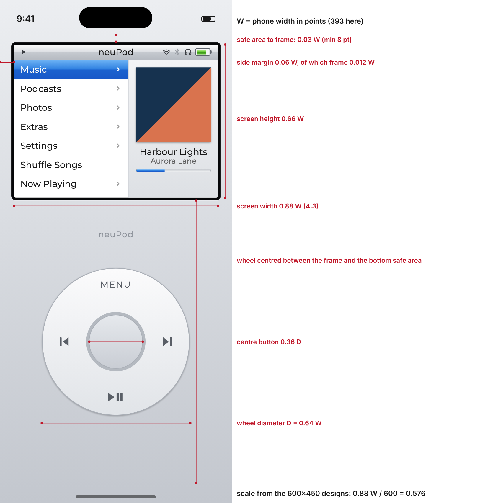

Everything is a ratio of **W, the phone's width in points**. The app lays the device out from these at any size.

| Part | Value |
| --- | --- |
| Screen | 0.88 W wide, 0.66 W high (4:3), centred horizontally |
| Screen frame (black glass) | 0.012 W on every side of the screen; outer corner radius 0.02 W; screen corner radius 0.008 W |
| Side margin, body edge to screen | 0.06 W (frame included) |
| Wheel diameter D | 0.64 W, centred horizontally |
| Centre button | 0.36 D across; a groove 0.04 R wide round it (R = D / 2) |
| Button glyphs | on a circle of radius 0.70 R: `MENU` at the top, next at the right, play/pause at the bottom, previous at the left |
| Wordmark | `neuPod`, 0.036 W high, centred between the frame and the wheel; omitted when that gap is under 44 pt |

**Scale.** The screens are designed at 600x450. The app lays them out at 600x450 and scales the whole screen uniformly
by **s = 0.88 W / 600**. It does not pick a different layout per phone.

| Phone | Screen (pt) | s | Small / Body / Title (pt) | Row, one / two lines (pt) | Wheel D (pt) | Centre (pt) |
| --- | --- | --- | --- | --- | --- | --- |
| 375x667 | 330 x 247.5 | 0.550 | 12.1 / 14.3 / 20.9 | 30.8 / 41.2 | 240 | 86 |
| 393x852 | 345.8 x 259.4 | 0.576 | 12.7 / 15.0 / 21.9 | 32.3 / 43.2 | 251.5 | 90.5 |
| 440x956 | 387.2 x 290.4 | 0.645 | 14.2 / 16.8 / 24.5 | 36.1 / 48.4 | 281.6 | 101 |

**Minimum.** The screen is never narrower than **320 pt** (s = 0.533, where Small is 11.7 pt). On a phone narrower than
364 pt the screen stays 320 pt and the side margin shrinks instead, down to 12 pt, so the narrowest supported phone is
344 pt wide. Portrait only. Tablets and landscape are out of scope for R1.

## 2. Fitting the phone

Two candidates, drawn at all three sizes in Classic and at 393x852 in Modern.

| | A: fills the phone (recommended) | B: fixed proportions |
| --- | --- | --- |
| 375x667 | 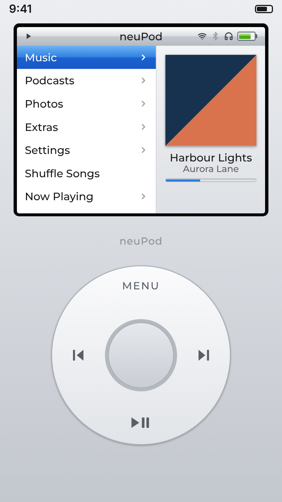 | 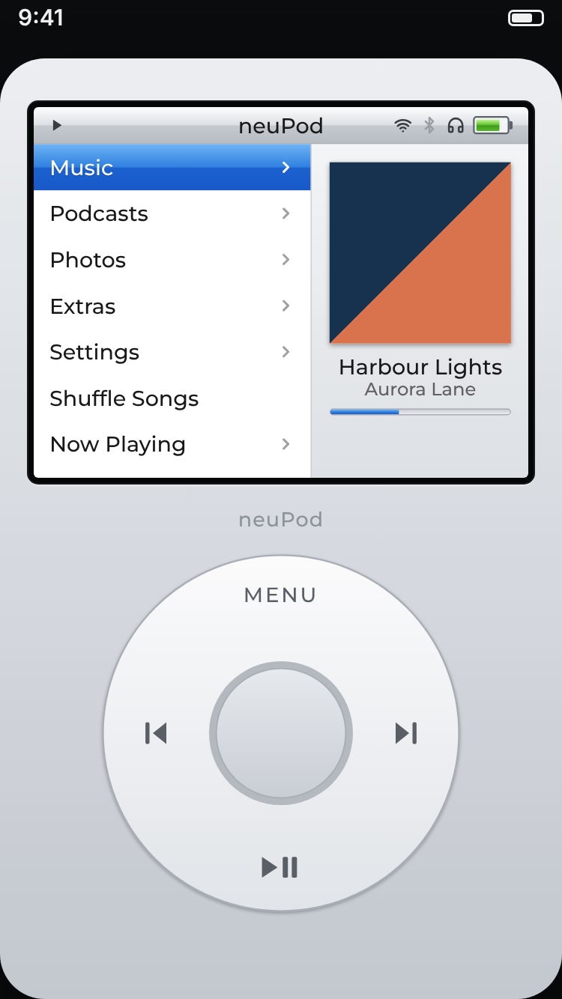 |
| 393x852 |  | 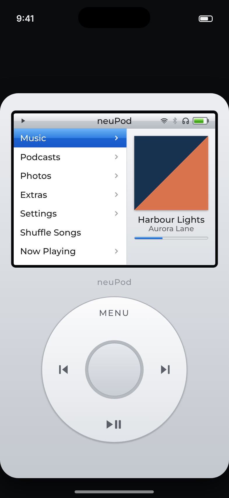 |
| 440x956 | 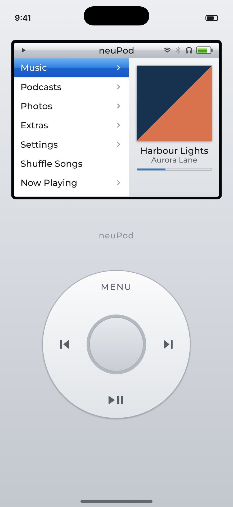 | 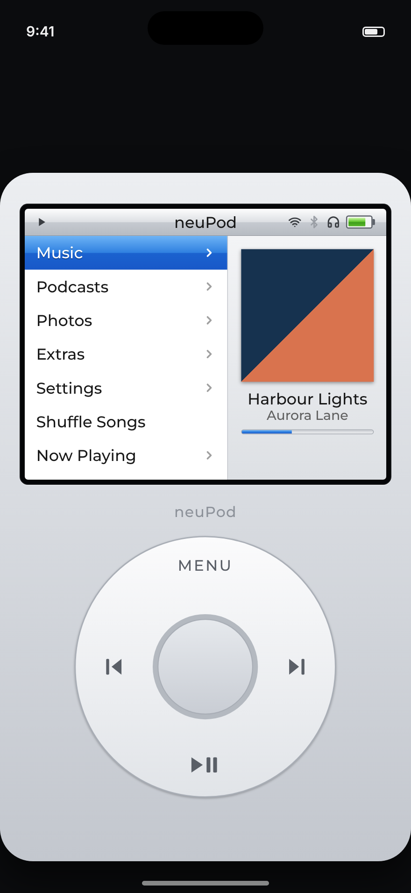 |
| Modern | 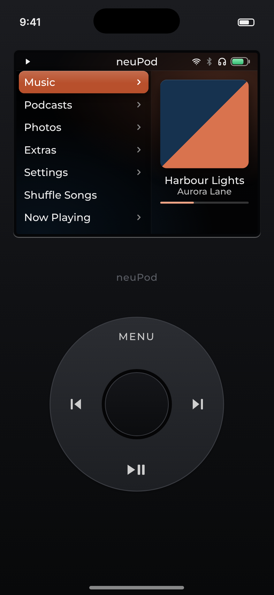 | 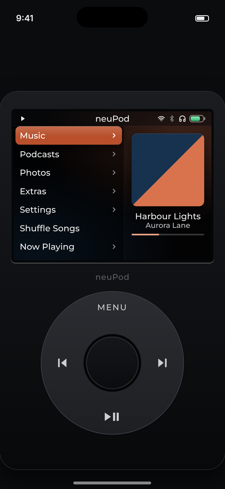 |

**A: the body fills the phone.** The body finish is the app's background, under the status bar, the notch or Dynamic
Island, the home indicator and the Android gesture bar. There is no outline and no surround.

- Frame top = top safe-area inset + max(8 pt, 0.03 W).
- Floor = phone height less max(bottom safe-area inset, 0.03 W).
- **Wheel centre = midway between the frame's bottom edge and the floor.** A taller phone therefore gets more body
  above and below the wheel; the screen and wheel do not grow.
- If the space between the frame and the floor is less than D + 24 pt, shrink D until it fits, to no less than 0.56 W.

**B: fixed proportions.** The body is W wide and **1.675 W** high with corner radius 0.08 W, sitting on a surround.

- Body bottom = the bottom safe-area inset (the phone's bottom edge where there is none). The surplus height shows as
  surround above the body, which keeps the wheel within reach of the thumb.
- Frame top = body top + 0.075 W. The wheel is centred between the frame and the body's bottom edge less 0.03 W.
- **The surround is `#0b0c0e` in every style and mode.** The silver body gets a drop shadow
  (`0 18px 40px rgba(0,0,0,.6)`); the black body also gets a 1 px `rgba(255,255,255,.14)` edge so it separates from it.
- If the body is taller than the safe height, fall back to A.

Why A: on a tall phone B leaves a dark band of 100 pt or more above the body that does nothing, and the body's corners
compete with the phone's own. A looks like the object in your hand and is simpler to build. B's advantage is that it
reads as a device with an outline, and it looks the same on every phone.

## 3. Body finishes

Two finishes. Colours run top to bottom.

| Part | Silver | Black |
| --- | --- | --- |
| Body | `#eceef1`, `#d9dce1` at 45 %, `#c3c7ce` | `#1b1c20`, `#101114` at 50 %, `#08090a` |
| Wheel ring | `#fbfbfc` to `#e1e4e8`, 1 px `#a9aeb6` edge | `#2b2d32` to `#1d1f23`, 1 px `#3a3c42` edge |
| Groove round the centre | `#b4b9c0` | `#050506` |
| Centre button | `#e6e9ed` to `#c9cdd4` | `#15161a` to `#0b0c0e` |
| Glyphs and `MENU` | `#5a5f67` (5.0:1 or better on the ring) | `#cfcfcf` (8.8:1 or better on the ring) |
| Wordmark | `#8d929a` | `#5c5f66` |
| Phone status bar text (fit A) | dark | light |
| Screen frame | `#050608` with a 1 px `rgba(255,255,255,.08)` inner edge, both finishes | |

**Rule.** The finish follows the **mode**, not the style: silver in Light, black in Dark. Classic Light is therefore
silver and Modern Dark is black, as drawn. This also covers Classic Dark (black) and Modern Light (silver), which the
UI styles design has not drawn yet; their screens are still blocked on that design's Open question 1, but the body is
not. Recommended on top: a **Body** setting (Automatic, Silver, Black), so an owner of a black neuPod can keep a black
body with a light screen. Both cross-combinations are drawn:

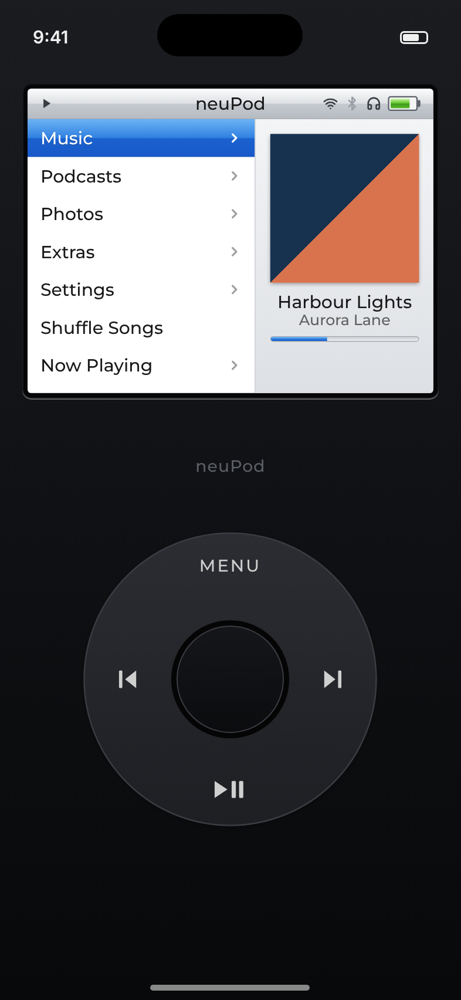
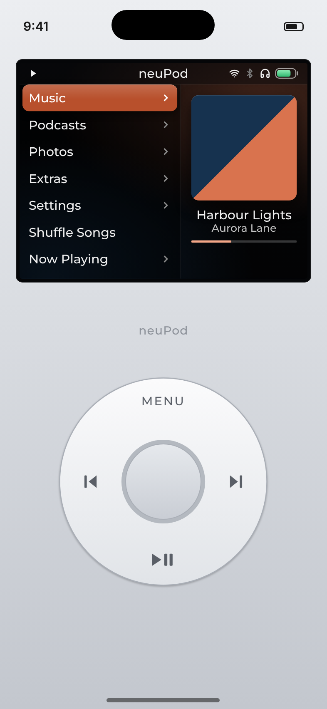

## 4. The click wheel

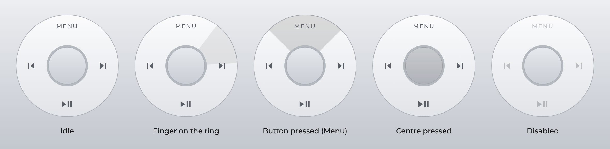
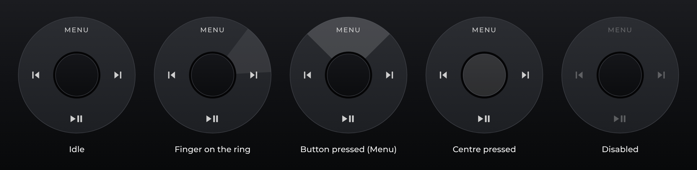

| State | Drawing |
| --- | --- |
| Idle | as the finish table |
| Finger on the ring | a 50 degree wedge of the ring under the finger, tinted `rgba(0,0,0,.07)` (silver) or `rgba(255,255,255,.08)` (black); it follows the finger |
| Button pressed | that button's 90 degree sector tinted `rgba(0,0,0,.13)` or `rgba(255,255,255,.14)`, from touch-down until release |
| Centre pressed | the centre button tinted the same |
| Disabled | glyphs and `MENU` at 35 % opacity; ring and centre unchanged. For any moment the wheel cannot act; no screen drawn here uses it |

### Hit zones

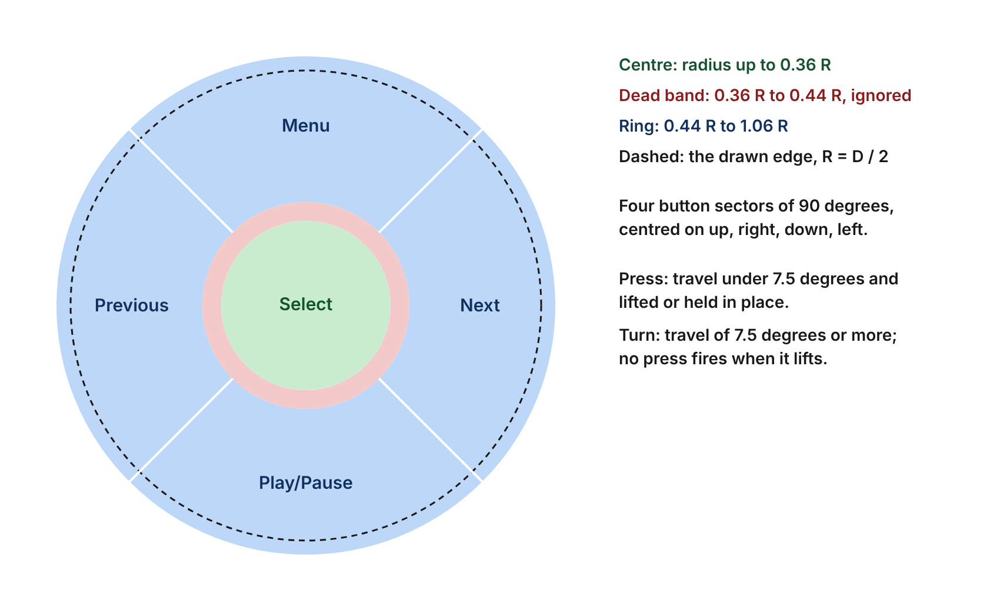

With R = D / 2, measured from the wheel's centre:

| Zone | Radius | Acts as |
| --- | --- | --- |
| Centre | 0 to 0.36 R | Select |
| Dead band | 0.36 R to 0.44 R | nothing; a touch that starts here is ignored |
| Ring | 0.44 R to 1.06 R (6 % beyond the drawn edge) | turning, and the four buttons |

The four buttons are 90 degree sectors of the ring centred on up (Menu), right (Next), down (Play/Pause) and left
(Previous). Every zone is at least 44 pt in its smaller dimension at the minimum screen size.

**Press or turn.** A touch that starts on the ring is undecided until it moves.

- **Turn:** the finger's angle about the centre has moved **7.5 degrees** or more from where it touched down. From then
  on it is a turn until the finger lifts, and no button fires on release.
- **Press:** the finger lifts, or is held, without reaching 7.5 degrees. The button is the sector under the touch-down
  point. The press shows and clicks at touch-down; if the touch then becomes a turn, the press is cancelled without
  acting.
- Once turning, track the angle wherever the finger goes, including over the centre and outside the ring. Ignore
  samples closer than 0.2 R to the centre, where the angle is unstable.
- A touch that starts on the centre is a Select press for as long as it stays within 0.44 R; sliding out cancels it.

## 5. Wheel behaviour, in numbers

The app ports the firmware's logic rather than imitating it. The constants are the firmware's
(`app/include/runtime_config.h`, `hal/include/hal_input.h`, `app/ui/ui_logic.[ch]`).

**Detents.** The device's wheel reports 96 positions a turn and 4 positions make a list step.

| | Value |
| --- | --- |
| One position | 3.75 degrees of finger travel |
| One list step (one detent) | **15 degrees**; 24 steps a turn |
| Direction | clockwise moves down a list, raises volume, seeks forward |

Convert the finger's angle change to positions (keep the fraction), counted from the touch-down angle so the 7.5 degree
threshold swallows nothing, and feed them to a port of `ui_accel_feed()`.

**Acceleration**, exactly as the firmware: an energy value gains the positions received and decays linearly to zero
over 150 ms; the step multiplier comes from the energy.

| Energy (positions within the window) | Multiplier | Roughly, at a steady speed |
| --- | --- | --- |
| under 12 | 1x | under 300 degrees a second |
| 12 or more | 2x | from 300 degrees a second |
| 24 or more | 4x | from 600 degrees a second |
| 40 or more | 8x | from 1,000 degrees a second |

A reversal drops the leftover positions of the old direction. The selection bar slides to an adjacent row in 80 ms; a
move of more than three rows jumps.

**Fast-scroll letter tile.** On an indexed list (Artists, Albums, Songs and the like), the letter tile and the index
rail appear while the multiplier is 2x or more, stay while the wheel moves, and fade over 150 ms once it has rested
for 250 ms. (Trigger and timings as the UI document describes them; confirm against `ui_list.c` and `ui_rail.c` when
porting.)

**Press and hold.**

| Control | Short press | Held |
| --- | --- | --- |
| Previous, Next | previous or next track (Previous restarts the track after 3 s of play) | after **600 ms**: scan at 10 times speed while held; applied 350 ms after release; ends itself after 30 s |
| Centre, on Now Playing | page 2 | after **500 ms**: seek mode. The wheel then moves the target by about 1/60 of the track a step (1 to 30 s); Select applies, Menu cancels, 10 s without input cancels |
| Centre, elsewhere | Select | nothing in R1 |
| Menu | back one level | nothing in R1 |
| Play/Pause | play or pause | nothing in R1 (Open question 4) |

**On Now Playing the wheel sets the phone's system volume** (owner decision 10). One step is one of the platform's
volume steps. While it turns, the device's volume bar replaces the progress bar, and returns to progress 1.2 s after
the wheel rests.

**Haptics.** One generator per kind, prepared in advance so the first tick is not late. Names are the platform APIs to
use; check them against current documentation.

| Event | iOS | Android |
| --- | --- | --- |
| Detent (each list step, volume step or seek step) | `UISelectionFeedbackGenerator.selectionChanged()` | `HapticFeedbackConstants.CLOCK_TICK`; `SEGMENT_FREQUENT_TICK` where available (API 34) |
| Button or centre down | `UIImpactFeedbackGenerator(style: .rigid)`, intensity 0.8 | `HapticFeedbackConstants.VIRTUAL_KEY` |
| Button or centre up | `UIImpactFeedbackGenerator(style: .light)`, intensity 0.5 | `HapticFeedbackConstants.VIRTUAL_KEY_RELEASE` (API 27) |
| A hold takes effect (scan starts, seek mode entered) | `UIImpactFeedbackGenerator(style: .medium)` | `HapticFeedbackConstants.LONG_PRESS` |
| End of a list reached | `UIImpactFeedbackGenerator(style: .soft)`, once | `HapticFeedbackConstants.REJECT` (API 30), once |

- When accelerated steps arrive faster than 30 a second, fire at most 30 ticks a second and drop the rest.
- No haptic on a press that is cancelled by becoming a turn, beyond the touch-down click already given.
- Haptics obey the system setting and a **Haptics** setting in the app (On by default).

**Click sound.** Off by default (**Click sound**: Off, On). When on: a tick of about 8 ms per detent and a lower click
per press, synthesised for this project (not a sample of any product), played as a system sound so it follows the
ringer switch and silent mode, never mixed into the music stream, and limited to 30 a second like the haptics.

**Other touches.**

- The first touch that lands on the wheel owns it until it lifts. Further touches on the wheel are ignored.
- The wheel's edge is 0.18 W from each side of the phone, clear of the system edge gestures.
- The system back gesture is **Menu**: Android's back gesture or button, and a swipe from the left edge on iOS. At
  Home, Android's back leaves the app as usual; on iOS it does nothing.
- The home-indicator swipe and the notification shade are the system's and are never intercepted.

## 6. Direct touch on the screen

| 1: the wheel only | 2: the wheel plus the screen (recommended) |
| --- | --- |
| 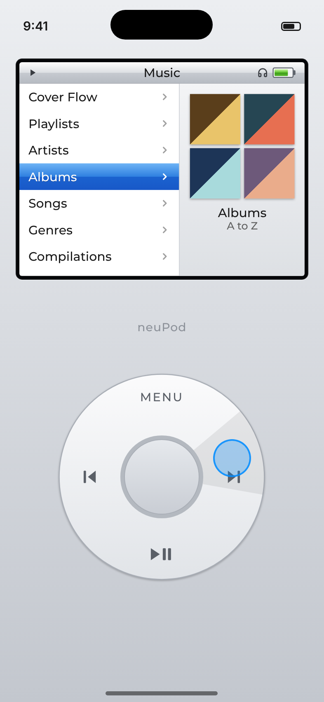 | 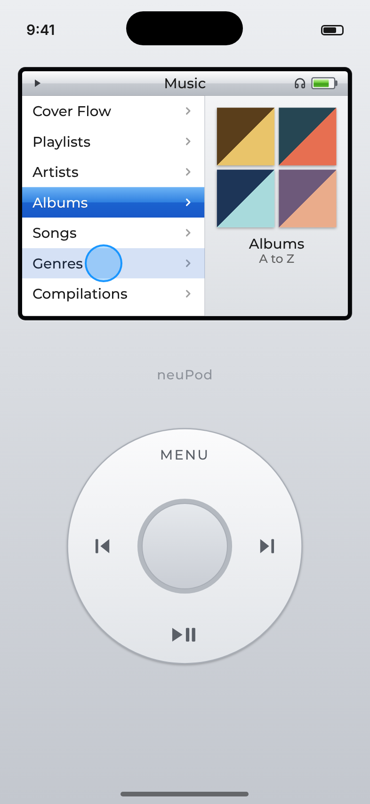 |

**Candidate 1.** The screen is display only. Everything goes through the wheel, as on the device.

**Candidate 2.** The wheel works exactly as in candidate 1, and the screen also takes touches:

- **Tap a row:** the selection bar jumps to it and it is activated, as wheel-to-it then Select. The row shows a pressed
  tint (`rgba(24,88,200,.18)` in Classic, `rgba(255,255,255,.12)` in Modern) from touch-down.
- **Drag a list:** it scrolls with the finger; the selection bar stays on the row nearest its place on screen, so it
  never leaves the view.
- **Cover Flow:** a horizontal drag moves the covers; a tap on the centre cover opens it.
- **Now Playing:** a tap on the art opens page 2. The progress bar is not draggable (seek mode is the way to seek).
- The status bar, the right-hand pane and panels' backgrounds take no touches. A panel's `OK` can be tapped.

Why 2: on a touch screen people tap what they see, and a row that ignores a tap feels broken. The cost: one-line rows are 31 to 36 pt high at the default text
size, under the 44 pt guideline. The wheel with Select is the path that meets the guideline; taps are a convenience on
top of it, and at the largest text tier the rows reach 44 pt.

## 7. Screens in the device

All at 393x852, fit A. Classic Light on the silver body, Modern Dark on the black body.

| Screen | Classic | Modern |
| --- | --- | --- |
| Home | 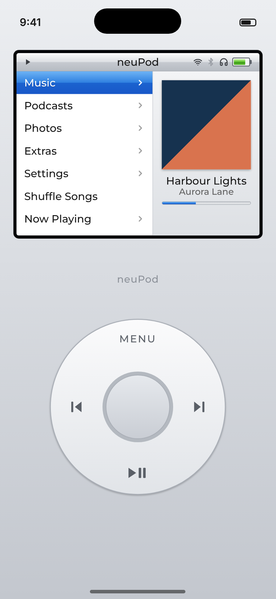 |  |
| Songs, wheel spinning, letter tile and rail | 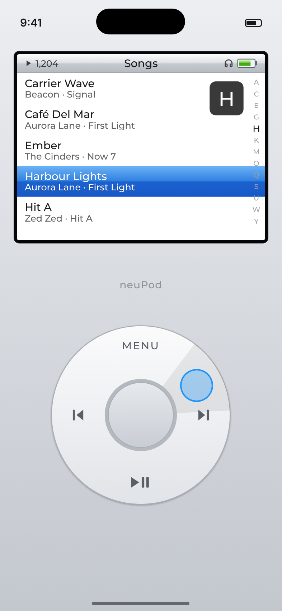 | 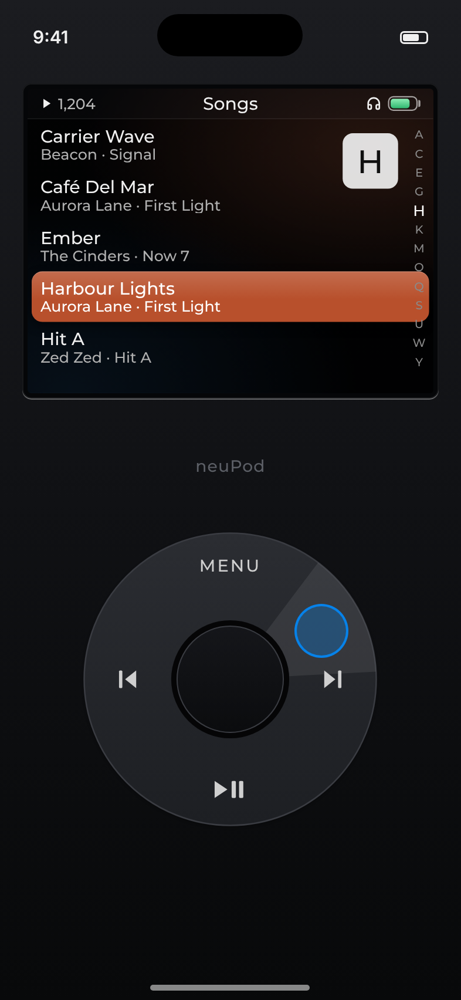 |
| Album with a disc heading | 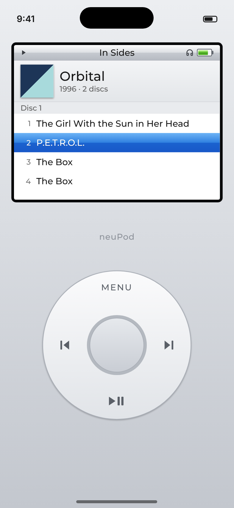 | 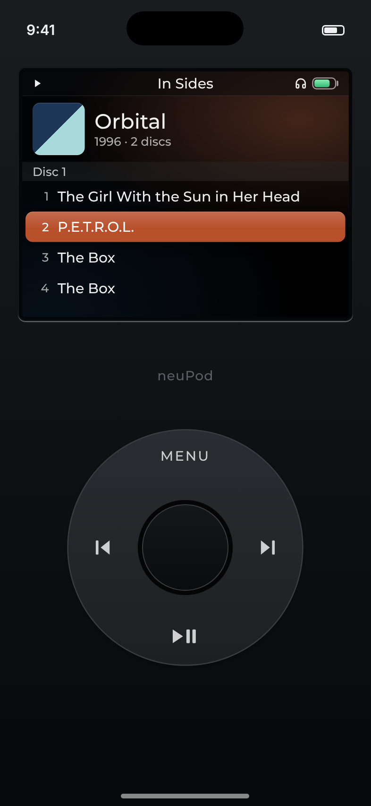 |
| Cover Flow | 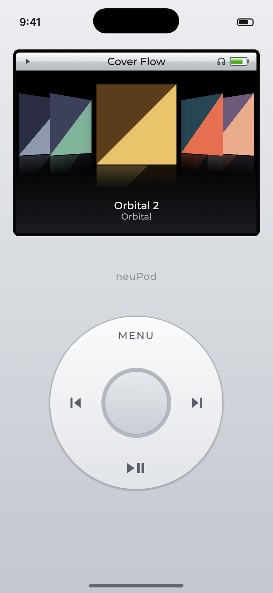 | 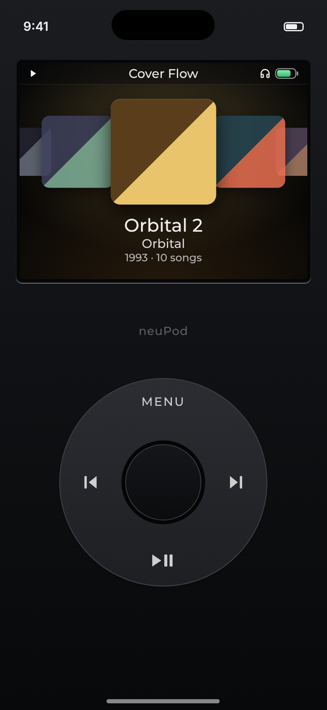 |
| Now Playing, at rest | 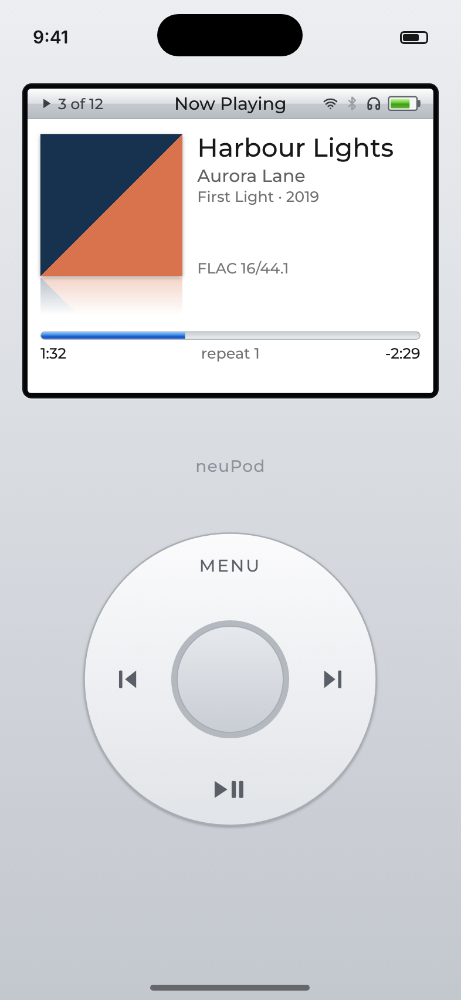 | 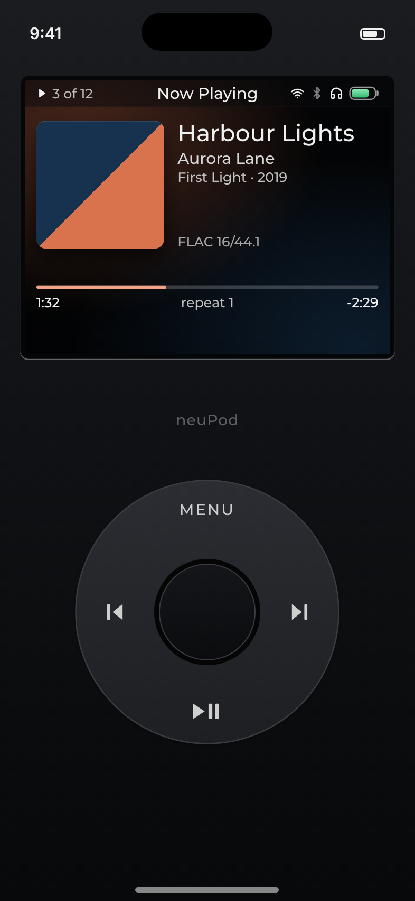 |
| Now Playing, wheel setting the volume | 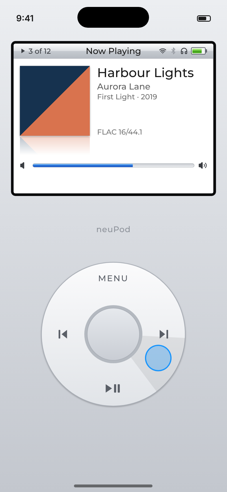 | 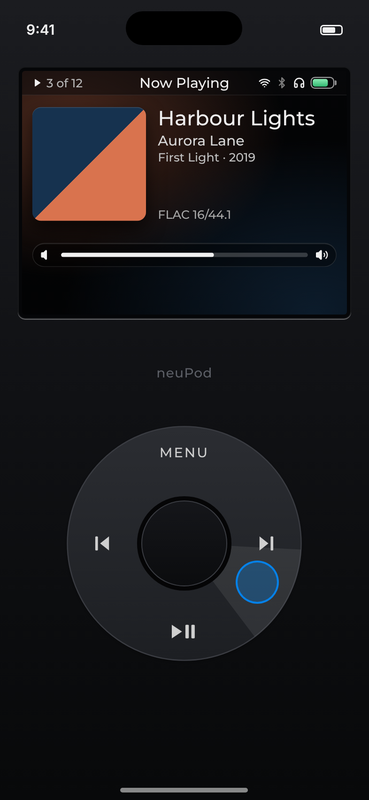 |
| Now Playing, seek mode | 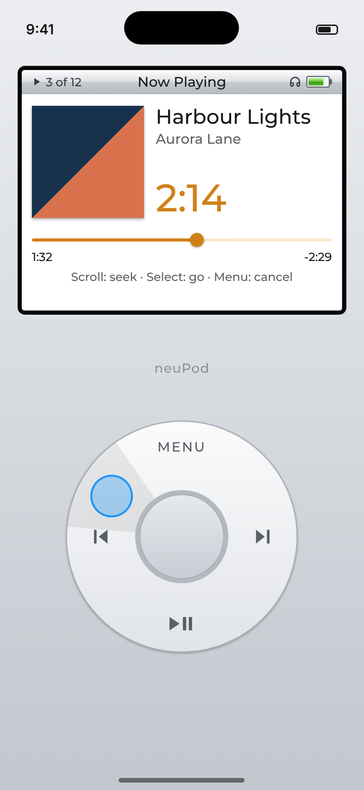 | 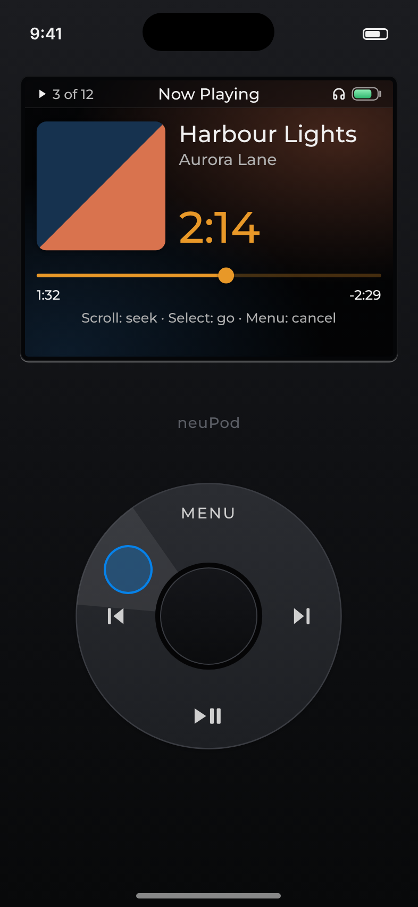 |
| Centred panel, centre pressed | 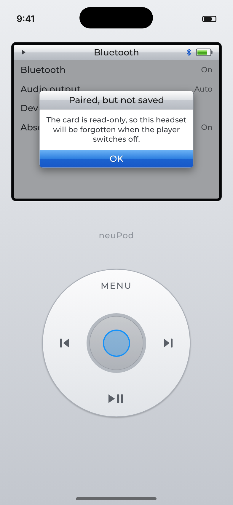 | 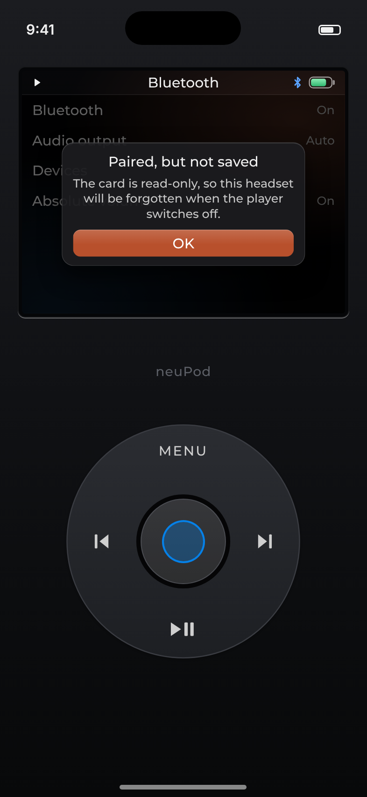 |
| Search, typing with the wheel | 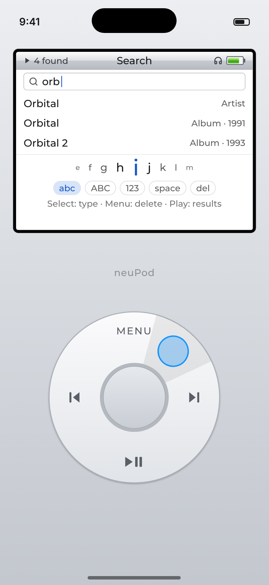 | 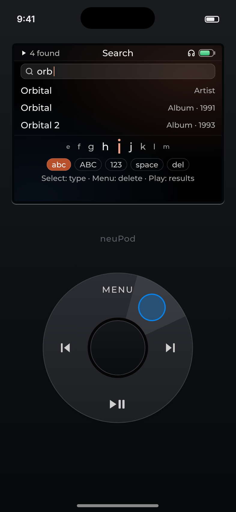 |
| Search, in the results | 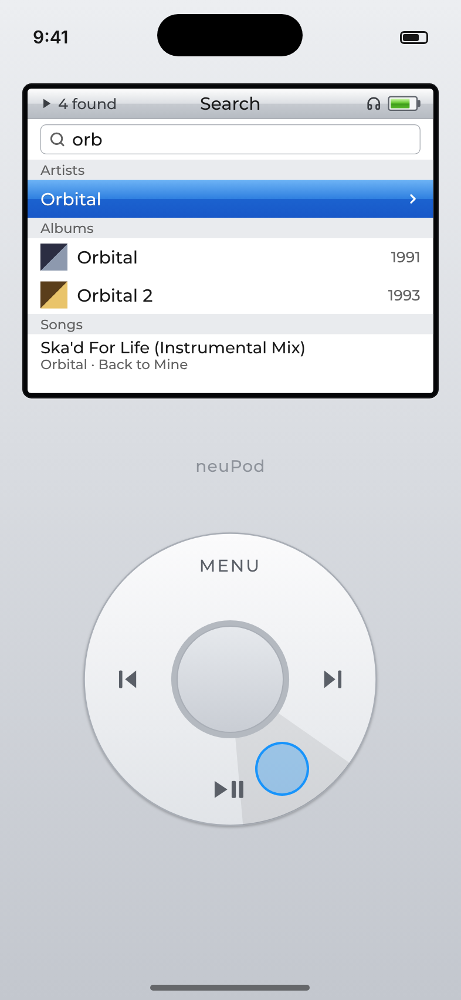 | 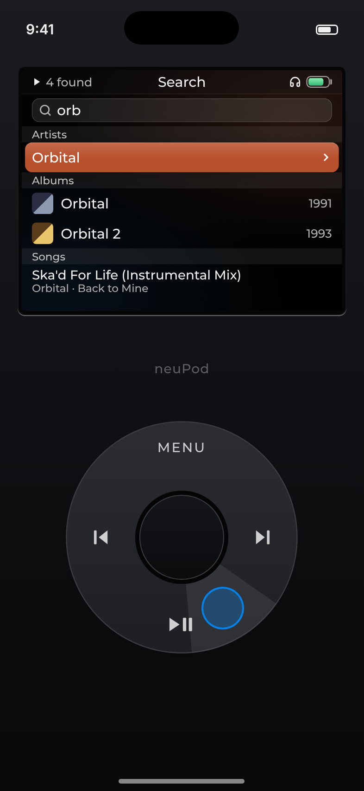 |

Notes on the screens the UI styles design had not drawn:

- **Letter tile and rail:** 82 px tile, radius 15, 52 px from the right edge and 21 px below the status bar, the letter
  at 48 px; the rail is 26 px wide at the right edge, every second letter at 17 px with the current one at 22 px.
  Classic: tile `rgba(24,24,24,.86)` with a white letter. Modern: tile `rgba(240,240,240,.92)` with a `#101010` letter.
- **Disc heading:** a 34 px band, Small text. Classic: `#e9ebee` with `#606060` text. Modern: `rgba(255,255,255,.07)`
  with `#c4c4c4`. Every disc gets one; track numbers restart under each. The album drawn is the owner's `In Sides`,
  whose first disc's track names are real.
- **Seek mode:** the seek time at 72 px in the style's amber (`#d08018` Classic, `#e89828` Modern), a 6 px amber bar
  with a 26 px knob on a soft amber track, the times, and the hint `Scroll: seek · Select: go · Menu: cancel`. The
  format line and the album line give way to it. Classic's amber on white is 3.1:1; it is used only at this large size, and
  is flagged in the UI styles design.
- **Search:** see below.

**Search, by the wheel.** Search is an item in the Music menu. It never raises the phone's keyboard, and tapping the
field does nothing. It reuses the device's text entry (`docs/ui-input.md`: the letter ring and mode chips, in search
mode, where every edit calls back so the list can filter live). The firmware has that widget but no Search screen yet,
so the screen below is new for both.

*Typing* (first drawing). From the top of the 405 px content area:

| Part | Size (design px) | Content |
| --- | --- | --- |
| Field | 44 high in a 60 band | magnifier, the text typed so far, a caret in the accent |
| Live results | three rows of 50 | the best three matches, with what each is at the right in Small (`Artist`, `Album · 1991`) |
| Letter ring | 64 band, hairline above | nine glyphs; the current one at 56 px in the accent, its neighbours at 30, 26, 22 and 18 px fading from ink to tertiary |
| Mode chips | 36 high, radius 18, in a 40 band | `abc`, `ABC`, `123`, `space`, `del`; the active one filled (Classic `#d8e4f8` with `#1858c8` text; Modern the accent with white text), the others outlined |
| Hint | Small, tertiary | `Select: type · Menu: delete · Play: results` |

The count of matches follows the play glyph in the status bar (`4 found`).

| Control | While typing |
| --- | --- |
| Wheel | turns the letter ring, one glyph a detent; the firmware's acceleration jumps three |
| Centre | types the current glyph (on `space` a space, on `del` deletes one) |
| Previous, Next | move along the mode chips |
| Menu | deletes one character; held, clears the field; on an empty field, leaves Search |
| Play/Pause | goes to the results |

*In the results* (second drawing). The field stays at the top without its caret, and the full results follow under
30 px headings `Artists`, `Albums`, `Songs`, as an ordinary list: the wheel scrolls it, the centre opens a row, and
**Menu returns to typing** with the text kept. Play/Pause is play or pause again.

With direct touch (candidate 2), a live result or a mode chip can also be tapped.

## 8. Largest text size

The 4:3 screen cannot reflow, so it honours the phone's text size by showing **fewer, larger rows**. The whole screen
stays 600x450; type and bars are multiplied by k and the row count drops.

| Tier | k | iOS text size | Android font scale | Rows, one line | Rows, two lines | Status bar | Row height (design px) |
| --- | --- | --- | --- | --- | --- | --- | --- |
| Standard | 1 | up to Large (the default) | under 1.15 | 7 | 5 | 45 | 56 / 75 (as built) |
| Large | 7/6 | Extra Large, Extra Extra Large | 1.15 to under 1.3 | 6 | 4 | 52 | 66 / 99 |
| Largest | 7/5 | Extra Extra Extra Large and the accessibility sizes | 1.3 and above | 5 | 3 | 63 | 77 / 129 |

On-phone sizes: Body is 15.0, 17.5 and 21.0 pt at 393 pt wide across the three tiers, and a one-line row is 32, 38 and
44 pt. The same tiers apply at every phone size, since the screen scales with the phone.

| | 7 rows | 6 rows | 5 rows |
| --- | --- | --- | --- |
| Home | 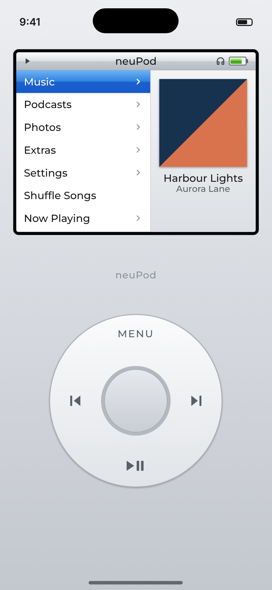 |  | 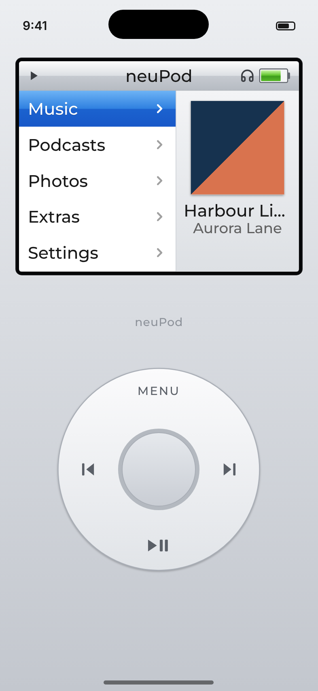 |
| Songs | 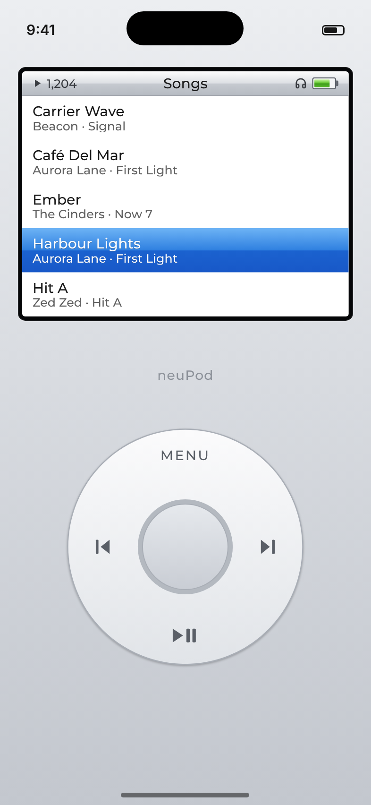 | 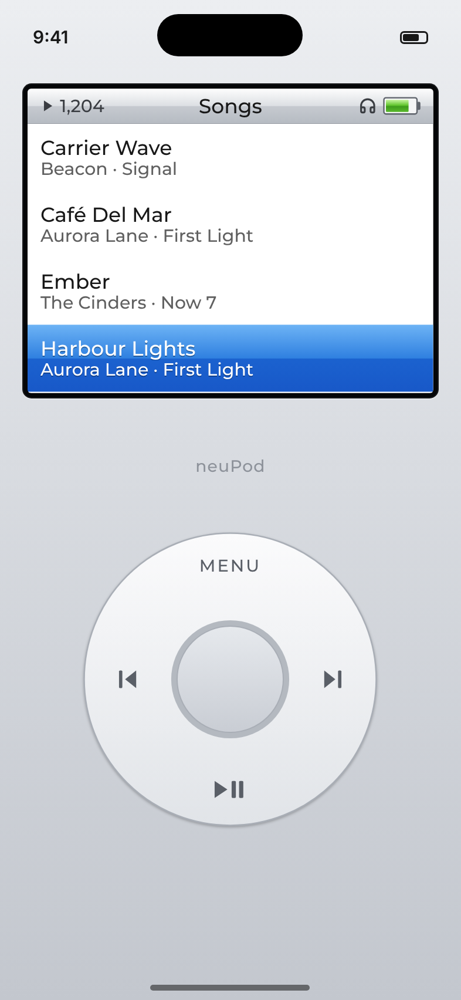 | 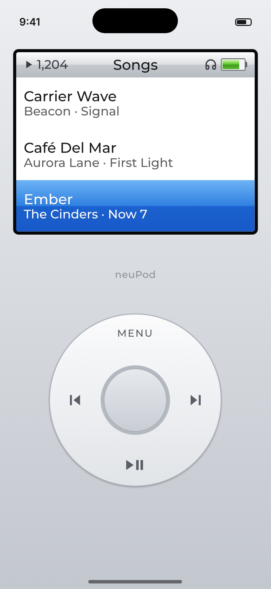 |

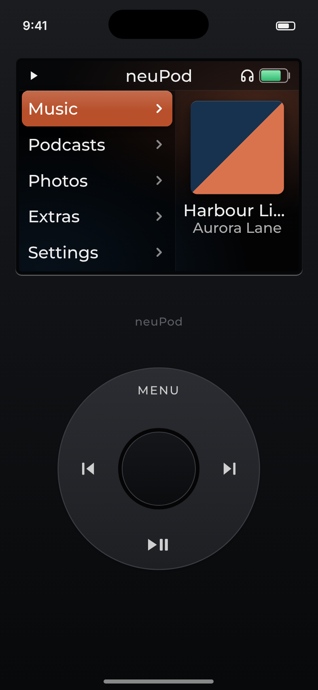

Rules:

- Lists simply show fewer rows; they already scroll. Text that no longer fits ends in an ellipsis, and the focused
  row's text scrolls as a ticker, as on the device.
- Fixed layouts scale their type by k and keep their structure: on Home the art shrinks to 200 px at the largest tier;
  on Now Playing the art shrinks to make room and the album line is dropped first, then the format line.
- Nothing may clip. The app's golden tests cover every screen at all three tiers.
- The accessibility sizes beyond the largest standard setting are capped at the largest tier (Open question 3).

## 9. Accessibility

With VoiceOver or TalkBack running, the picture of the device is not the interface; the semantics below are.

**The screen.** Each row is one element, in order, so swiping moves row by row.

| Element | Label | Action |
| --- | --- | --- |
| A row | its text, then its second line or value, then position: `Albums, 4 of 7` | activate opens it (always, whichever touch candidate is chosen) |
| A greyed row | its text, then the reason: `Carrier Wave, AAC, can't play` | none; announced as dimmed |
| Status bar | one element: `Playing, shuffle on, track 3 of 12, headphones, battery 78 percent` | none |
| Screen title | announced when the screen changes | |
| A panel | focus moves to it; its title, then its text | `OK` |

**The wheel** is one adjustable element.

| | Lists and menus | Now Playing | Seek mode |
| --- | --- | --- | --- |
| Label | `Click wheel` | `Volume` | `Seek` |
| Value | the focused row, as above | `62 percent` | `2 minutes 14 seconds of 4 minutes 1` |
| Increment | next row | volume up one step | forward one step |
| Decrement | previous row | volume down one step | back one step |

It carries five named actions, in this order: **Select**, **Menu**, **Previous track**, **Next track**, and **Play**
or **Pause** according to the state. The four buttons and the centre are not separate elements, so the screen reader
does not stop on them twice.

- A change made by the wheel is announced through the element's value, not as a separate announcement.
- Haptics still fire. With Reduce Motion on, the selection bar and screen changes do not animate.
- Switch control and external keyboards: arrow up and down move the selection, Return is Select, Escape is Menu, Space
  is Play/Pause, left and right arrows are Previous and Next.
- Contrast and "nothing by colour alone" are inherited from the screens; the wheel's glyphs meet 4.5:1 in both finishes.

## 10. The phone's status bar

**Recommended: shown, above the device.** The phone's status bar stays visible, drawn over the body finish (fit A) or
the surround (fit B), with dark text on silver and light text on black.

- The device has no clock, by the owner's decision; on a phone the system clock is right there and people rely on it.
- On a phone with a notch or Dynamic Island the space is reserved whether the bar is shown or not, so hiding it gains
  nothing. On a home-button phone it would gain 20 pt.
- Hidden makes a purer picture and is what a game would do; it is the alternative, not drawn separately because it
  differs only by the missing text.
- Merged (the phone's time or signal inside the device's bar) is not recommended: it changes the device's screen, which
  the UI styles design fixes.

In the device's own status bar the battery shows the **phone's** battery, the output icon follows the phone's route
(headphones for wired, the Bluetooth glyph in blue for Bluetooth), and Wi-Fi is not shown in R1 because the app makes
no network connection.

## Open questions

For the owner. Nothing here is settled by the drawings.

| # | Question | What was drawn meanwhile |
| --- | --- | --- |
| 1 | **Fit A or B** | Both, at three sizes; the screens use A |
| 2 | **Direct touch**: wheel only, or wheel plus the screen. Candidate 2's one-line rows are under 44 pt at the default text size | Both; candidate 2 recommended |
| 3 | **Text beyond the largest tier.** The accessibility sizes are capped at 5 rows. Is that acceptable, or should those sizes switch to a plain, reflowing list view outside the device picture? | Capped |
| 4 | **Holding Play/Pause.** The device has a separate Hold; the phone has its own lock. Should a hold do anything (stop and clear the queue, for example)? | Nothing |
| 5 | **Body setting.** Follow the mode automatically only, or also offer Silver and Black as a choice | Automatic, with both cross-combinations drawn |
| 6 | **Proportions.** The screen is wider and the frame thinner than the donor shell, for legibility. Closer to the real device would mean a screen of about 0.82 W (Body 14 pt at 393) | Our own proportions |
| 7 | **AirPlay and other routes.** The device's icon set has headphones, a jack plug and Bluetooth. What shows for AirPlay, the phone's speaker and USB audio? | Not drawn; speaker shows no icon |
| 8 | **The wordmark on the body.** Keep `neuPod` between the screen and the wheel, or leave the body plain | Drawn, small and low-contrast |
| 9 | **Left-edge swipe as Menu on iOS** | Specified as Menu |
| 10 | **Click sound.** Whether it plays through headphones or only the phone's speaker | System sound, follows the ringer switch |
| 11 | **Search placement.** An item in the Music menu, or on Home | Music menu |
| 13 | **Search, three live results.** Three rows fit above the letter ring. Fewer and larger, or none until Play/Pause? At the larger text tiers only two, then one, will fit | Three |
| 12 | **Classic Dark and Modern Light screens** are still undrawn (UI styles Open question 1); only their bodies are covered here | Bodies only |
