# UI styles: Classic and Modern, 21 November 2026

A design session with the owner on how the firmware UI should look and behave. It builds on the
[12 November design review](../2026-11-12-ui-review/README.md) and overrides it where the two disagree.

**The brief (owner):** the interface should look and feel like the original click-wheel player's. New components and some
animation will be added, but as much of the original as possible is kept, for familiarity.

This folder holds:

- this README: the decisions, the rules and the exact values;
- `mockups/`: every screen that was drawn, as a PNG and as the standalone HTML it was rendered from (the HTML is the
  reference for exact colours, gradients and sizes);
- [IMPLEMENTATION-BRIEF.md](IMPLEMENTATION-BRIEF.md): the working instructions for building it;
- [PROGRESS.md](PROGRESS.md): the checklist of work, ticked off as it merges.

The mock-ups are design intent drawn in HTML, not firmware output. They are drawn at **600x450**, the touch AMOLED boards'
profile, in Montserrat Medium (22 / 26 / 38 px) with Lucide icons. Album art squares are placeholders. Track names on the
first screens are the test fixtures; the Music screens use real names from the owner's library.

## Owner decisions (21 November 2026)

1. **Two styles, two modes each.** A theme is a *style* (Classic or Modern) and a *mode* (Light or Dark). Auto still
   switches the mode when the backlight dims.
2. **Classic is the 6G look as shipped**: gradient selection bar, glossy status bar, green shaded battery. It is drawn
   fresh, not copied from the original's artwork.
3. **Modern goes beyond it**: "art-led glass". True black, a backdrop and accent taken from the album art, translucent
   tinted chrome. It borrows the layering idea from current phone design but not live blur or refraction.
4. **A monochrome style is parked.** When it returns it may bring its own fonts, provided they go through the same
   rendering rules (display-text filter, glyph coverage, licences screen).
5. **The AMOLED leads.** Design at 600x450 first; 480x360 and 320x240 are scale-downs that must pass the layout audit.
6. **Status bar is the same on every screen**: play state at the left, title in the middle, hardware icons at the right.
7. **Play state is one of three glyph groups**: play; play then the two-arrow loop (repeat); play then the crossing
   arrows (shuffle). Merged single icons were looked for in five open icon sets and none works at status-bar size.
8. **Track position stays** (`3 of 12`) after the play glyph.
9. **No clock.** There is no RTC, so the time is unknown after every cold start. The clock is dropped everywhere.
10. **Headphones icon** only while a 3.5 mm plug is in the jack. **A jack-plug icon** in its place when the output is set
    to Line. **Bluetooth icon is blue** when a headset is connected or in use.
11. **Volume on Now Playing is not permanent.** Turning the wheel swaps the progress bar for a volume bar with a quiet
    speaker at one end and a loud one at the other; it reverts when the wheel rests. No dB figure.
12. **Volume on any other screen** swaps the status-bar title for a small volume bar for about a second. The bottom HUD
    strip goes away.
13. **The format is less prominent**: one small grey line (`FLAC 16/44.1`), no pill. The output is not written on Now
    Playing at all; the status-bar icon says it.
14. **The toast strip goes away.** Messages go to one of three places (below).

## What a style owns

Today a theme is a table of 14 colours (`app/ui/ui_theme.[ch]`) and components such as the battery are fixed drawings.
From now on:

| A style owns | Shared by every style |
| --- | --- |
| Its colour table, one per mode, with the same 14 token names | Layout: every position and size in `ui_metrics_t` |
| A small set of skins: status bar fill, battery, selection bar, scroll bar, progress and volume bars, panel, art frame, list ground | Row counts (7 single-line, 5 two-line) |
| Whether it draws an art backdrop | Fonts, glyph coverage, the display-text filter |
| | Wheel and button behaviour, copy, screen structure |

Both styles therefore run the same screens and the same snapshot tours.

## Status bar

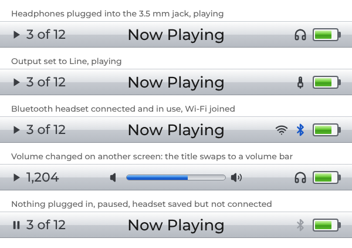
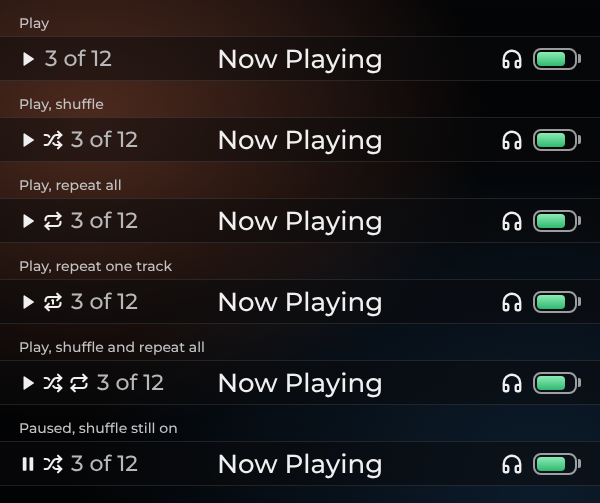

Three zones, in this order, on every screen:

**Left: play state, then context.**

| State | Glyphs |
| --- | --- |
| Stopped | nothing |
| Playing | play triangle |
| Paused | pause bars |
| Shuffle on | transport glyph, then crossing arrows (Lucide `shuffle`) |
| Repeat all | transport glyph, then two-arrow loop (Lucide `repeat`) |
| Repeat one | transport glyph, then loop with a 1 (Lucide `repeat-1`) |
| Shuffle and repeat | transport glyph, crossing arrows, loop |

The mode glyphs stay while paused. After the glyphs comes the screen's context text where it has one: `3 of 12` on Now
Playing, the count on a list (`1,204`, `9 albums`). Home and menus show the glyphs only.

**Centre: the screen title.** It gives way, for one to two seconds, to a message or to the volume bar (see Feedback).

**Right: hardware, right-aligned, always in this order:** Wi-Fi, Bluetooth, output (headphones or jack plug), lock,
battery. A member that does not apply is not drawn and the others close up toward the battery.

| Icon | Shown | Colour |
| --- | --- | --- |
| Wi-Fi | station joined | ink |
| Bluetooth | a headset is saved | dim when not connected; **blue** when connected or in use |
| Headphones | a plug is in the 3.5 mm jack and the output is wired | ink |
| Jack plug | Audio output is set to Line | ink |
| Battery | always | style skin; rules as built (green charging, red below 15 %) |

The jack-plug glyph is not in Lucide and was drawn for this design: see `mockups/classic-status-states.html`.

Not yet drawn, listed so they are not forgotten: fast-forward and rewind while scanning, opening (matters for network
streaming), can't-play, recording, and the three busy dots for a background library update.

## Now Playing

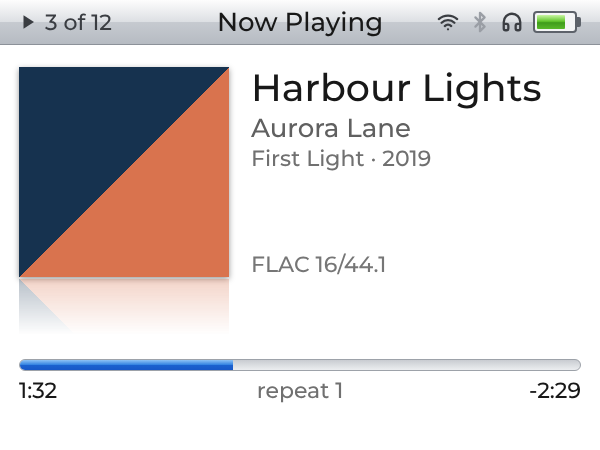
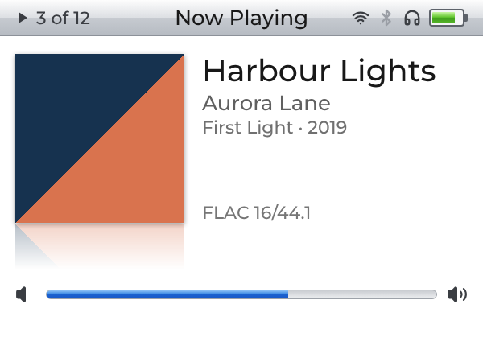
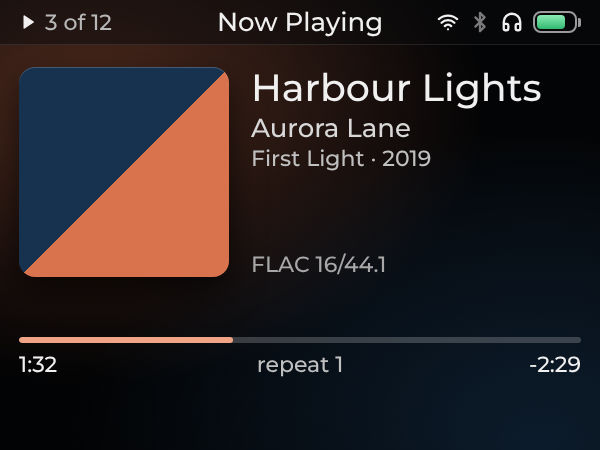
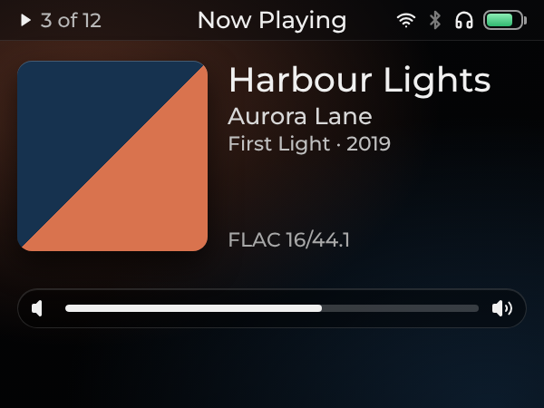

- At rest: art, title, artist, `Album . Year`, the small format line, the progress bar with elapsed and remaining and the
  repeat / shuffle word between them.
- Wheel moves: the progress bar and the times are replaced in place by the volume bar with a speaker glyph at each end.
  It returns to progress when the wheel has rested (use the existing 1.2 s hold).
- The permanent volume strip, the dB figure, the format pill and the output pill are removed.
- Seek mode and page 2 are unchanged in behaviour and take the style's skins.

## Feedback: three places

The sliding toast strip and the bottom volume HUD are removed in both styles. A message goes to exactly one of:

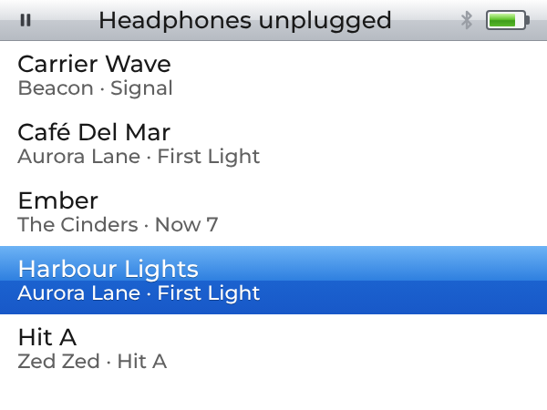
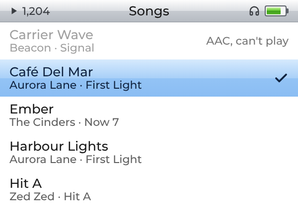
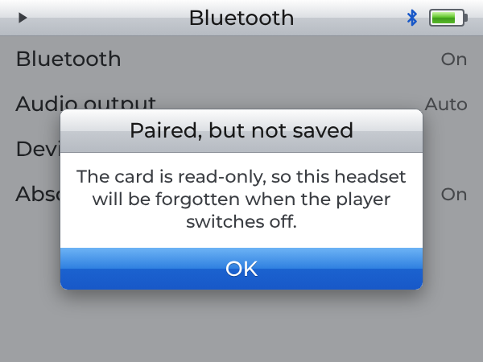

| Place | Use it when | It must not | Messages that move here |
| --- | --- | --- | --- |
| **Status bar title** (swaps for about 2 s) | Something changed by itself and the user only needs to know | Need an answer; exceed about 24 characters | `Headphones unplugged`, `Couldn't reconnect - paused`, `Line out off`, `No audio output`, headset connected / disconnected, `Library updated`, and the transient refusals `Busy`, `Can't pair now`, `Not now`, `Bluetooth is starting` |
| **The row** | The feedback is about the row under the selection bar | Say anything unrelated to that row | Success as a flash of the bar with a tick: `Added to On-The-Go`, `Removed from On-The-Go`. A reason on a greyed row, visible before the press: `Not in the library`, `Not an audio device`, `Plug into the jack first`, `No speaker in this device`, `Nothing playing`, unplayable codecs (`AAC, can't play`) |
| **Centred panel** (Select or Menu dismisses) | Something was lost or is about to be | Be used for routine confirmations | `Battery empty`, `Can't save: settings full`, `Paired, but not saved (read-only card)`, `Card is full`, `Card read error`, `Library update stopped` |

Rules:

- Volume and a message share the status-bar title. Volume wins; the message shows after it.
- `Can't open: too many screens` is an internal limit and should not reach the user: fix the cause or log it.
- The firmware raises about 50 toasts today (`grep ui_toast_show app/ui`). Every one must be assigned to a place; none
  may be silently dropped.

## Music screens

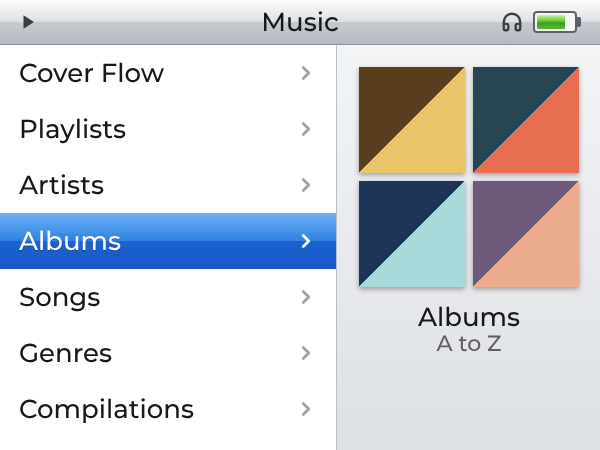
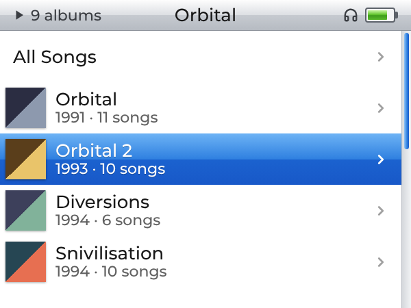
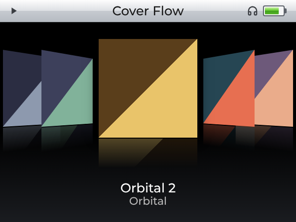
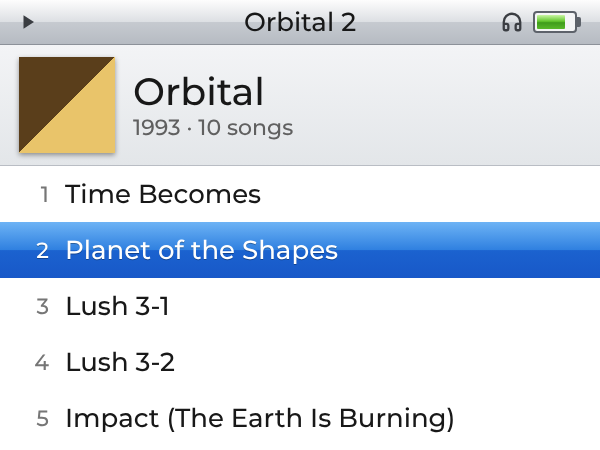
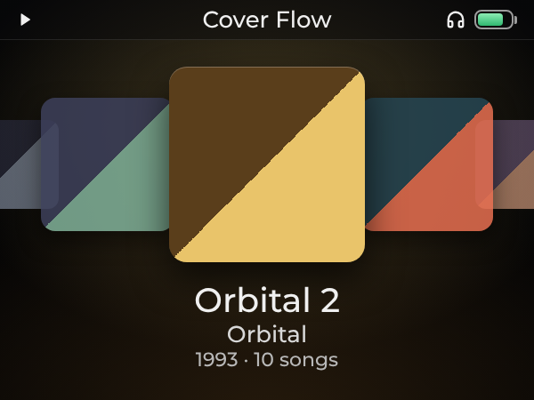
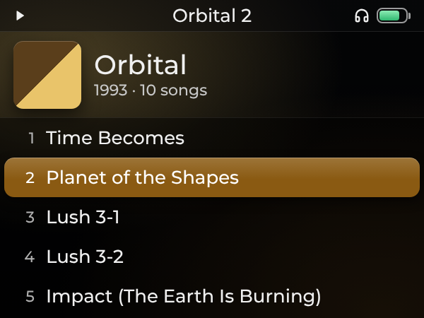

- **Music menu**: split like Home. Cover Flow, Playlists, Artists, Albums, Songs, Genres, Compilations, Update Library;
  the right pane previews the highlighted item (four covers for Albums).
- **An artist's albums**: All Songs first, then a two-line row per album with a cover thumbnail, the year and the song
  count. Drawn in year order (designer's call, see Open questions).
- **Cover Flow**: Classic is the angled version with reflections on black. Modern is five flat rounded covers
  (220 / 150 / 100 px) over a backdrop washed in the centre album's colours.
- **Album**: the status-bar title is the album; a header shows the cover, the artist, the year and the song count; then
  numbered tracks.

## Classic, Light: the values

All at 600x450. `A | B` in a gradient means a hard step at the midpoint (the gloss line).

| Part | Value |
| --- | --- |
| Ground / text | `#ffffff`; ink `#181818`, secondary `#606060`, tertiary `#767676`, disabled `#a0a0a0` |
| Status bar | 45 px; top to bottom `#fdfdfd`, `#dcdfe3` at 50 % \| `#c6cad0` at 51 %, `#b6bbc2`; 1 px `#8c9199` under it; glyphs `#3a3d42`, dim `#9a9ea5`, Bluetooth active `#1858c8` |
| Battery | body 44x22, 2 px `#5d626a` outline, radius 4, inside `#f4f5f6`; fill top to bottom `#c9f5a3`, `#63c62f` at 45 % \| `#3f9c1c` at 55 %, `#58b82a`; terminal 4x10 |
| Selection bar | full width, square; `#6db3f5`, `#2f80e0` at 50 % \| `#1b62cf` at 51 %, `#1858c8`; white text with a 1 px dark shadow |
| Selection flash | `#d6eafd`, `#a9d0f8` \| `#93c3f5`, `#8abdf3`; text and tick `#10233f` |
| Right pane (Home, Music) | `#f3f4f6` to `#dde0e4`, 1 px `#b9bdc4` at its left; art with a soft drop shadow |
| Scroll bar | 14 px gutter `#d5d8dc` to `#f1f2f4`; thumb left to right `#8fc3f6`, `#2f80e0`, `#1858c8`, radius 4 |
| Progress / volume bar | 12 px, radius 6; track `#c9ccd1` to `#eceef0` with 1 px `#9da2a9`; fill as the selection bar, starting `#8fc3f6` |
| Art | square corners; on Now Playing a 56 px reflection at 30 % fading to nothing |
| Album header | 121 px, `#f3f4f6` to `#e3e6e9`, 1 px `#b9bdc4` under it, 96 px art |
| Panel | 452 px wide, white, 1 px `#6f757d`, radius 10; title strip in the status-bar gradient; the `OK` row is a 52 px selection bar; scrim `rgba(40,44,52,.45)` |
| Cover Flow | black to `#1a1c20`; centre 200 px, sides 156 px turned 58 degrees, reflections |

## Modern, Dark: the values

| Part | Value |
| --- | --- |
| Ground | `#050608`, effectively black |
| Backdrop | two soft washes in the art's two main colours (one near a top corner at about 45 to 55 % strength, one near the opposite bottom corner at about 75 to 85 %), under a darkening scrim of 30 % at the top to 50 to 55 % at the bottom. Made **once per track** from the art (a small blurred, darkened copy), never blurred live. No art: the ground alone |
| Accent | the art's dominant colour with its lightness clamped until white text on it is at least 4.5:1. In the mock-ups `#d9734e` becomes `#b8502c` (7:1) and `#e9c46a` becomes `#8a5a12` (5.9:1) |
| Text | ink `#f0f0f0`, secondary `#b0b0b0` to `#c8c8c8`, disabled `#7c7c7c` |
| Status bar | `rgba(10,10,12,.5)` over the backdrop, 1 px `rgba(255,255,255,.10)` under it; dim glyphs `#7a7a7a`; Bluetooth active `#5aa2ff` (fixed, not the accent) |
| Battery | capsule 44x22, 2 px `rgba(255,255,255,.6)`, radius 8; fill `#8cecb4` to `#30b870`, radius 4; terminal 3x9 |
| List ground | `rgba(0,0,0,.38)` to `.42` over the backdrop; dividers `rgba(255,255,255,.08)` |
| Selection bar | inset 6 px, radius 14 (one line) or 16 (two lines); the accent, with a highlight of `rgba(255,255,255,.16)` fading out by 55 % of its height, a 1 px light top edge `rgba(255,255,255,.28)` and a shadow `0 6px 16px rgba(0,0,0,.45)`; white text |
| Selection flash | the bar keeps its colour and gains a 3 px ring `rgba(255,255,255,.6)` and a tick |
| Scroll bar | 4 px, `rgba(255,255,255,.45)`, no track |
| Progress bar | 6 px, radius 3; track `rgba(255,255,255,.2)`; fill a light tint of the art colour (`#f2a586` in the mock-up) |
| Volume (Now Playing) | a floating capsule 44 px high, radius 22, `rgba(0,0,0,.4)`, 1 px `rgba(255,255,255,.14)`; bar 8 px, fill `#f0f0f0` |
| Art | radius 16, shadow `0 12px 30px rgba(0,0,0,.6)`, 1 px light top edge |
| Panel | 452 px wide, `rgba(28,28,32,.92)`, 1 px `rgba(255,255,255,.16)`, radius 22; `OK` is a 50 px accent button, radius 14; scrim `rgba(0,0,0,.6)` |
| Cover Flow | flat covers 220 / 150 / 100 px, radii 20 / 16 / 12, opacity 1 / .85 / .6 |

The existing rule that every colour is RGB565-exact was written for the LCD. Keep it for flat fills; gradient stops and
alpha blends on the AMOLED are exempt.

## Other resolutions

Lengths scale through the existing metrics profiles: 600x450 values times 4/5 for 480x360 and 8/15 for 320x240, rounded
as `ui_metrics.c` already does. Row counts do not change. On 320x240 the left of the status bar is tight when shuffle and
repeat are both on; the track position may drop out in that one state.

## Open questions

Not decided. Do not settle these by guessing; ask the owner.

**Gate 2 (22 November 2026), app spec owner decision 13:** 9 is decided (placeholder cover, "Nothing playing" and the
song count). Classic Light is adjusted to 4.5:1 contrast where the values below fall short, and Bluetooth saved versus
connected gets a cue besides colour (bears on 4).

| # | Question | What was drawn meanwhile |
| --- | --- | --- |
| 1 | **Classic Dark and Modern Light** have not been designed | Only Classic Light and Modern Dark exist |
| 2 | **Typeface.** The 6G used a Helvetica-like face; both styles use Montserrat for now | Montserrat |
| 3 | **Row "done" feedback in Classic**: the pale flash drawn, or the original's quick blink | Pale flash with a tick |
| 4 | **Saved but unconnected Bluetooth**: dimmed icon (as built) or hidden | Dimmed |
| 5 | **Modern recolouring**: in Cover Flow and Album the backdrop and accent follow the album on screen; elsewhere the playing track. Or always the playing track? | Follows the album on screen in those two views |
| 6 | **Album order under an artist**: by year or by name | By year |
| 7 | **Thumbnails on album rows** cost a decode per row | Drawn with thumbnails |
| 8 | **Classic Cover Flow angled** needs the performance test first; the firmware has only the flat one | Angled |
| 9 | **Home right-hand pane when nothing is playing**, now that the clock is gone | Not drawn |
| 10 | **Performance.** Modern depends on alpha blending and a full-screen backdrop at speed on a microcontroller. Untested | See the brief, phase 0 |
| 11 | **Long names** (for example `Ministry of Sound - the Annual IV - [Disc 1 of 2] (Judge Jules) (Disc 1)`): tickers in lists; Cover Flow's title line needs a rule | Not drawn |
| 12 | **Left of the status bar at 320x240** with shuffle and repeat both on | Not drawn |

## What this overrides

- 12 November review: the toast strip (DS-5, owner decision 8), the volume HUD (NP-4), the Now Playing pills and volume
  strip (NP-1), the clock in the status bar's left slot (DS-3), the rounded inset selection bar as the only look (DS-4;
  it becomes Modern's).
- `docs/ui.md` describes the UI as built. It stays correct until each piece of this design merges, and is updated in the
  same PR as the code.
