# App Custom mode, 25 November 2026

A fourth mode for the phone app's device view. Light, Dark and Auto stay as they are: the body finish follows the
mode. **Custom** lets the user choose the colour and the transparency of three parts (the body, the wheel, the centre
button), and where a part is see-through a picture of a neuPod board shows from underneath, the "clear case" look.

It answers the owner's request of 25 November 2026 (backlog [AP-1](../../backlog.md)) and extends the
[device view design](../2026-11-21-app-device-view/README.md). **It changes paint, not layout**: every position, hit
zone and wheel number in that design stands.

This folder holds:

- this README: decisions, rules and exact values;
- `mockups/`: 20 drawings as PNG and as the standalone HTML they were rendered from;
- `render.py`: the generator. It imports the device view's `render.py` for the geometry and the screens, and its
  `hsv`, `paint` and `increase_contrast` functions are the reference implementation of the rules in section 4;
- [IMPLEMENTATION-BRIEF.md](IMPLEMENTATION-BRIEF.md): the working instructions for building it;
- [PROGRESS.md](PROGRESS.md): the checklist of work.

The mock-ups are design intent drawn in HTML, not app output. A blue circle marks a finger and is not part of the UI.
The Home screen inside the device is the UI styles mock-up reused unchanged, so it shows items and a Wi-Fi icon the
app does not have; only the body, the wheel and the new screens are this design.

**Drawn fresh.** Nothing here copies Apple's artwork, and no colour or look is named after an Apple product colour.
**The board pictures are placeholders** drawn by `render.py` and labelled as such in every drawing. They are not
neuPod boards and must not ship.

## Owner decisions (25 November 2026)

1. **Mode is Light, Dark, Auto, Custom.** Custom sets the colour and transparency of the body, the wheel and the
   centre button separately, with a colour wheel as the picker. A custom look carries its own screen choice (Light,
   Dark or Auto) and its board picture. Style (Classic or Modern) stays a separate setting.
2. **The app never scrolls and never shows scroll bars**, vertical or horizontal: the device always fits the phone.
   Inside the 4:3 screen, Custom's screens avoid scrolling too where they can.
3. **Three starter looks ship with the app**: Harbour, Sea glass and Clear case.

Everything else below is the designer's proposal until the owner confirms it.

## Recommendations at a glance

| # | Question | Recommendation | Alternatives |
| --- | --- | --- | --- |
| 1 | Where it lives | Mode cycles in place through four values; a **Custom look** row under it opens the list of looks | Mode opens a page of four choices; the row hidden unless Mode is Custom |
| 2 | The editor | **In the 4:3 screen**, with the real body and wheel round it as the live preview | A full-phone editor with a small picture of the device |
| 3 | Input | **Both.** The wheel does everything; touching the colour wheel on the screen is a shortcut | Wheel only; touch only |
| 4 | Readability | Legends are **pure black or pure white**, chosen by the luminance under them, switching at **0.179**; a part that still falls short is painted flat | Legends on backing plates; clamping the colour |
| 5 | Transparency | Body sharp, up to **85 %**; wheel and centre over a **pre-blurred** copy, up to **60 %**; a solid cap under the phone's status bar | One picture, sharp everywhere, with plates under the legends |
| 6 | Board pictures | **1200 x 3120 px**, anchored on the wheel's centre, three in the set | A picture fitted to each phone |
| 7 | Presets | **Six looks**, listed in Settings > Custom look; saved as they are edited | Eight, in a scrolling list; an explicit Save |
| 8 | Accessibility | Reduce Transparency paints every part solid; Increase Contrast also moves brightness until legends reach **7:1** | Ignoring the settings in Custom |
| 9 | Classic and Modern | Both work unchanged; the black screen frame keeps any body off the screen | A neutral band round the screen |
| 10 | Data model | Each part stores **hue, saturation, brightness, transparency** as whole numbers; RGB is computed | Storing RGB and alpha |

## 1. Where it lives

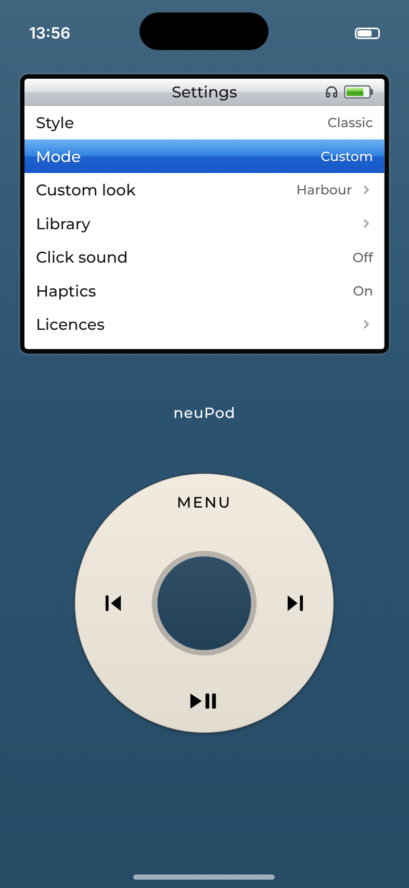

- **Mode** cycles in place on Select, in the owner's order: Light, Dark, Auto, Custom. It has no chevron, because it
  changes a value and does not open a list. (The build cycles Auto, Light, Dark today; the order changes.)
- **Custom look** sits directly under Mode and is always shown. Its value is the name of the look in use; its chevron
  opens the list of looks. Opening a look from that list sets Mode to Custom, so there is one way in and no greyed row.
- When Mode is not Custom the row still shows the last look's name. Nothing about the look is lost by leaving Custom.

Why: the design system's rules are that a row which toggles has no chevron and a row which opens a list has one, and
that the five controls do the same thing everywhere. Two rows keep both rules. Settings stays within seven rows at
the standard text size as drawn (Style, Mode, Custom look, Library, Click sound, Haptics, Licences); the
specification's other Settings items need a home that keeps to owner decision 2 (Open question 6).

Alternatives. *Mode opens a page* of four radio rows with Custom leading on to the looks: one more press for the
common change between Light and Dark. *The row hidden unless Mode is Custom*: the list changes length under the
selection bar, and the design system says empty is stated, not hidden.

## 2. The editor

The editor is three screens deep, each an ordinary device screen. **The body, the wheel and the centre button round
the screen are the live preview**: every change repaints them at once, at full size, on the real thing.

| Custom look | A look | A part |
| --- | --- | --- |
| 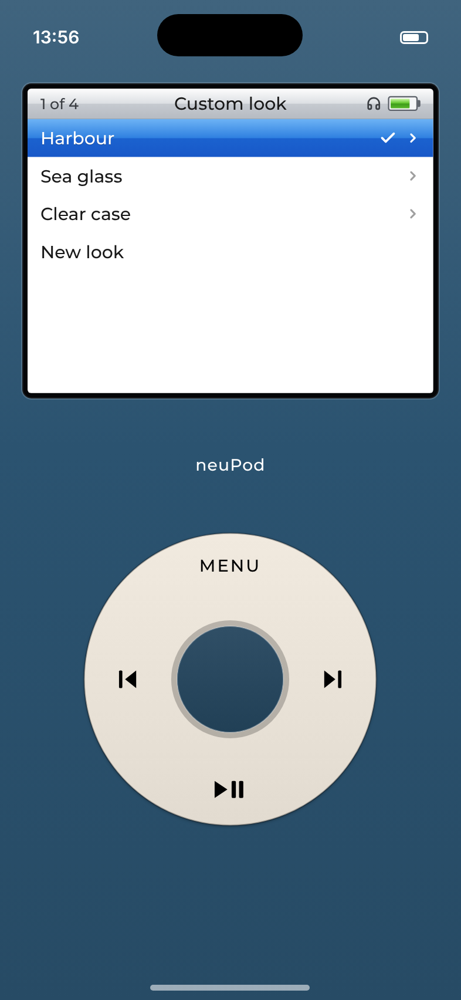 | 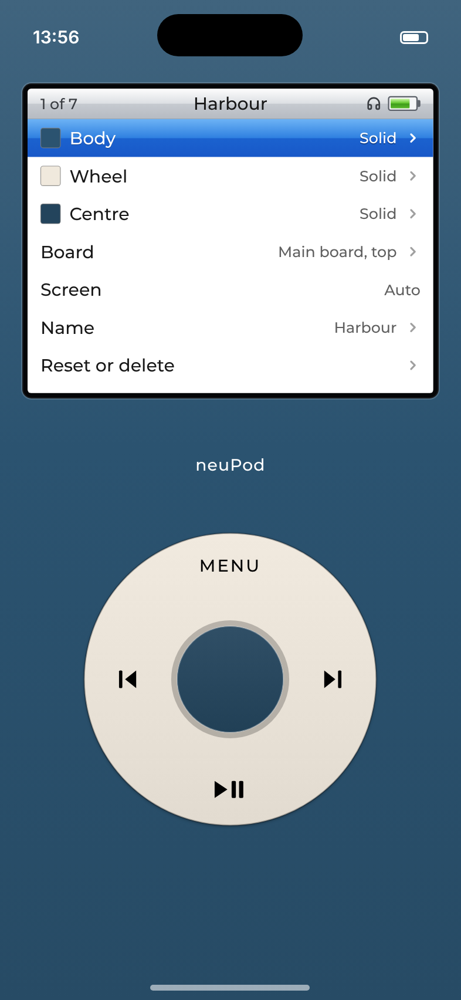 | 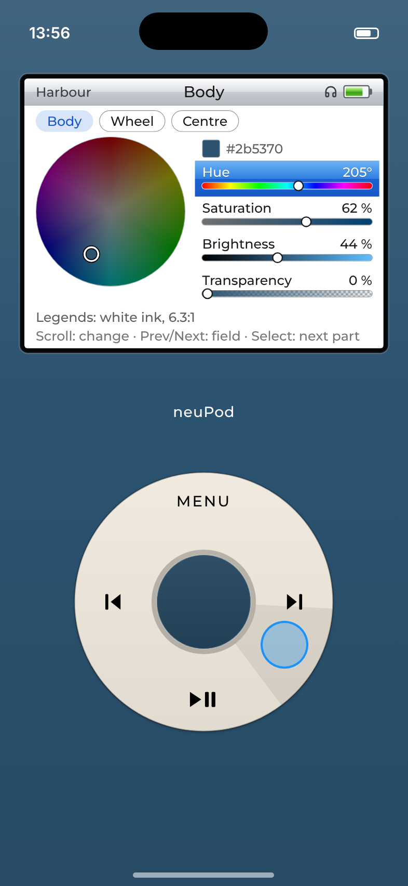 |

**Custom look** (the list). One row per look, then `New look`. The look in use carries a tick. Moving the selection
bar onto a look previews it on the body after the wheel has rested for 250 ms; Menu leaves with the look in use
unchanged. Select opens the look and makes it the look in use.

**A look.** Seven rows, no scrolling:

| Row | Value | Select |
| --- | --- | --- |
| Body | swatch, then `Solid` or `55 % clear` | opens the part editor on Body |
| Wheel | the same | opens the part editor on Wheel |
| Centre | the same | opens the part editor on Centre |
| Board | the board's name | opens the board picker |
| Screen | `Light`, `Dark` or `Auto` | cycles in place |
| Name | the look's name | opens the device's text entry (the letter ring), 16 characters at most |
| Reset or delete | | opens two rows: `Reset to default`, `Delete look` |

**A part** (the colour wheel). At 600x450, under the 45 px status bar, whose title is the part and whose left slot is
the look's name:

| Part | Size (design px) | Content |
| --- | --- | --- |
| Part tabs | 36 high, radius 18, in a 52 band | `Body`, `Wheel`, `Centre`; the one being edited filled (Classic `#d8e4f8` with `#1858c8` text; Modern the accent with white text), the others outlined |
| Colour wheel | 250 across, 19 from the left | hue round the circle, red at the top, clockwise; saturation from the centre (none) to the rim (full); the whole disc darkened by the brightness. A 26 px ring marks the colour |
| Swatch and hex | 40 band, right column | a 30 px swatch and the colour as `#rrggbb`. Read only |
| Four fields | 60 each, right column | `Hue` 0 to 359 degrees, `Saturation`, `Brightness` and `Transparency` in per cent; each a name, a value and a 10 px bar with an 18 px knob. The focused field is the screen's one selection bar |
| Legend note | Small, secondary, 30 band | what the rule in section 4 did: `Legends: white ink, 6.3:1`, with `painted flat` or `Held at 50 % so MENU stays readable` when it applies |
| Hint | Small, tertiary, 36 band | `Scroll: change · Prev/Next: field · Select: next part` |

| Wheel, see-through | Centre, pressed |
| --- | --- |
| 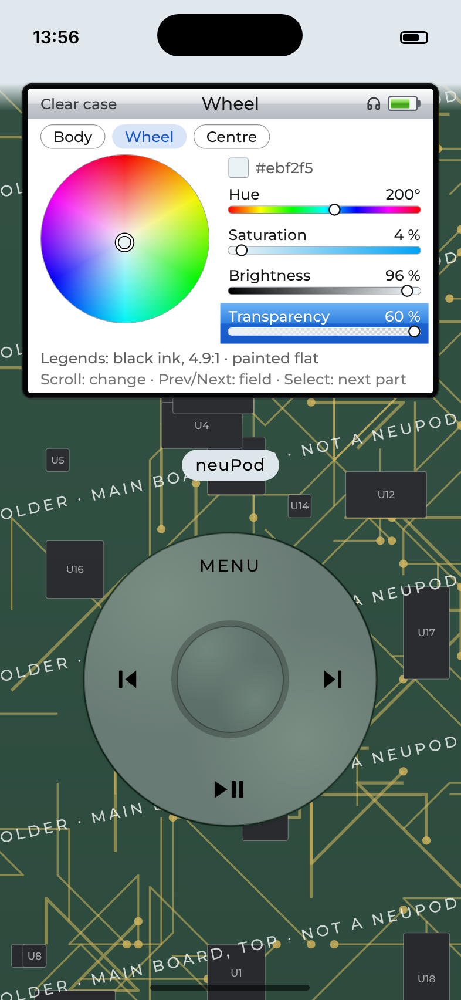 | 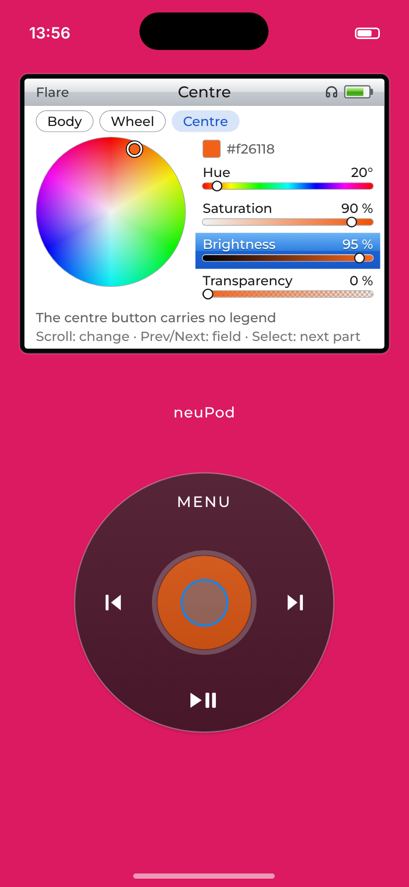 |

**Which part is being edited** is said three ways, none by colour alone: the status-bar title, the filled tab, and a
single pulse of that part's edge on the body (the edge goes from 30 % to 100 % ink and back over 400 ms; skipped with
Reduce Motion on).

**The board picker.** A split screen like Home: the three boards at the left, a thumbnail of the highlighted one at
the right. Moving the bar previews the board on the body after 250 ms; Select chooses it.

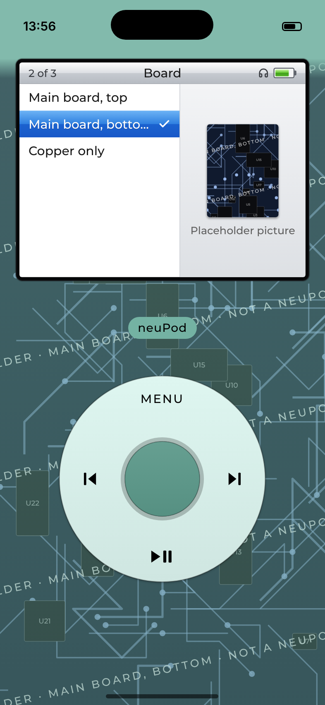

Alternative considered: a full-phone editor with sliders under a small picture of the device. It has more room, but
the preview shrinks to a thumbnail, the wheel stops being the input, and it is the "generic app with a neuPod logo"
the specification rules out.

## 3. Input

**Recommendation: both, with the wheel as the complete path.**

| Control | In the part editor |
| --- | --- |
| Wheel | changes the focused field, one step a detent, with the firmware's acceleration |
| Previous, Next | move the focus along the four fields, as they move along the mode chips in Search |
| Centre | the next part: Body, Wheel, Centre, Body |
| Menu | back to the look. Every change is already saved |
| Play/Pause | play or pause, as everywhere |

| Field | Step a detent | A full range at rest speed |
| --- | --- | --- |
| Hue | 5 degrees | three turns of the wheel (72 detents); under half a turn at 8x |
| Saturation, Brightness | 4 % | about one turn (25 detents) |
| Transparency | 5 % | 12 detents for the wheel and centre, 17 for the body |

Hue wraps round; the other three stop at their ends with the end-of-list haptic.

**Does a colour wheel turned by the click wheel hold up?** For hue, yes, and it is the natural pairing: both are
circles and clockwise means onward in both. On its own, no. A colour has three dimensions and a part has a fourth,
and the wheel moves one value at a time, so it needs the four fields and a way to step between them. With them, a
whole look can be made by the wheel alone. The wheel's angle is never mapped straight onto the hue (touch at three
o'clock, get that hue): the wheel is relative everywhere else, its four compass points are buttons, and the first
7.5 degrees decide press or turn.

**Direct touch**, when the device view's candidate 2 is in force:

- touching or dragging on the colour wheel sets hue and saturation together, and moves the focus to Hue;
- dragging along a field's bar sets that field; tapping a field focuses it;
- tapping a part tab changes the part.

Touch is the quick way to a rough colour; the wheel then refines it a step at a time. The colour wheel is 144 pt
across on a 393 pt phone, so a fingertip covers some 15 degrees of hue: good for getting near, not for finishing.

Why not wheel only: the first colour is three turns away. Why not touch only: the device view may yet be wheel only
(gate 1), the screen reader's adjustable wheel must be able to do all of it, and a finger hides the colour it is
choosing. With a screen reader the wheel's label is the field (`Hue`) and its value `205 degrees, body`; increment
and decrement step it; the part tabs and fields are also reachable as elements.

## 4. Readability on any colour

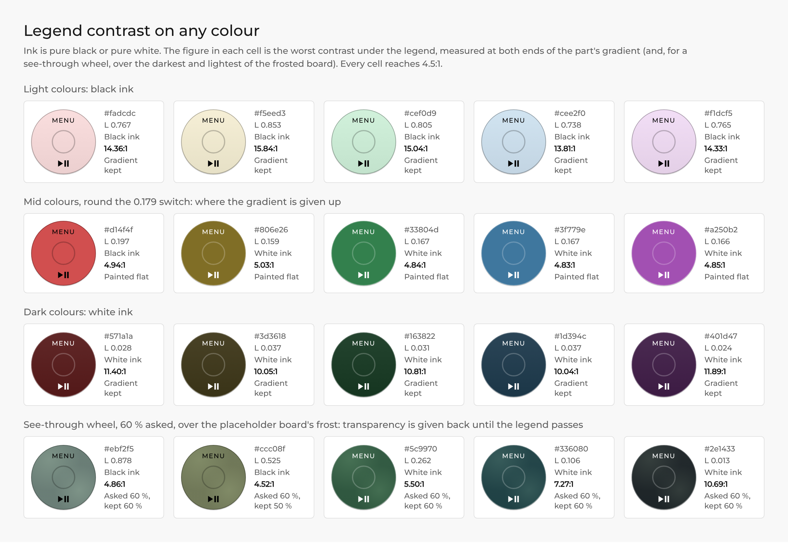

The legends are `MENU`, play/pause, previous and next on the wheel, the `neuPod` wordmark on the body, and the
phone's own status bar. All must reach **4.5:1** on whatever is chosen.

**The rule.** Legend ink is **pure black `#000000` or pure white `#ffffff`**, nothing between.

1. Work out the colours under the legend: the part's colour at both ends of its gradient (section 5 gives the
   gradients), each composited over the darkest and the lightest of what shows through if the part is see-through.
2. For each ink take its worst contrast over those colours (WCAG 2 relative luminance). Use the ink whose worst case
   is higher; black on a tie. For one flat colour this is black at luminance **0.179 or more**, white below.
3. If that worst case is under 4.5:1, **paint the part flat**: its one colour, no gradient. Go to 1.
4. If it is still under 4.5:1 (only possible when the part is see-through), **give back transparency in steps of
   5 %** and go to 1 each time. At 0 % a flat colour always passes.

Why it always ends: against one opaque colour, the better of pure black and pure white is never under **4.58:1**
(the worst case is at luminance 0.179). Greys for ink would not have that property, which is why the device view's
`#5a5f67` and `#cfcfcf` glyphs are not used in Custom.

Numbers:

| | Value |
| --- | --- |
| Ink | `#000000` or `#ffffff` |
| Switch, one flat colour | luminance 0.179 (black at or above) |
| Target | 4.5:1; 7:1 with Increase Contrast (section 8) |
| Guaranteed for any opaque flat colour | 4.58:1 |
| Step when giving back transparency | 5 % |

Which legend uses what:

| Legend | Measured against | Notes |
| --- | --- | --- |
| The wheel's four legends | the wheel's gradient ends, over the blurred board's darkest and lightest colour when see-through | one ink for all four, and for the ring's edge and groove |
| Wordmark | the body's gradient ends | when the body is see-through the wordmark sits on a **badge** (section 5), a flat patch of the body's colour, so it is measured against that one colour |
| Phone status bar | the body's top colour alone (the solid cap, section 5) | black ink maps to the dark status bar style, white to the light one |
| Centre button | nothing | it carries no legend; its ink is used only for its edge and pressed tint |

The stored look is never changed by the rule. The editor's legend note says what was done, and the Transparency field
keeps showing what was asked.

Alternatives. *Backing plates under every legend*: provable, but four stickers on a clear wheel. *Clamping the
colour* until grey ink passes, as Modern clamps its accent: the user then cannot have the colour they chose, on an
opaque part where nothing is forcing it. Giving up the gradient costs far less than either.

## 5. Transparency

| Part see-through | Clear case |
| --- | --- |
| 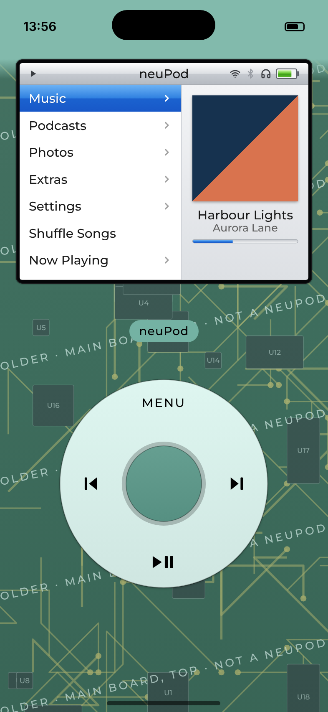 | 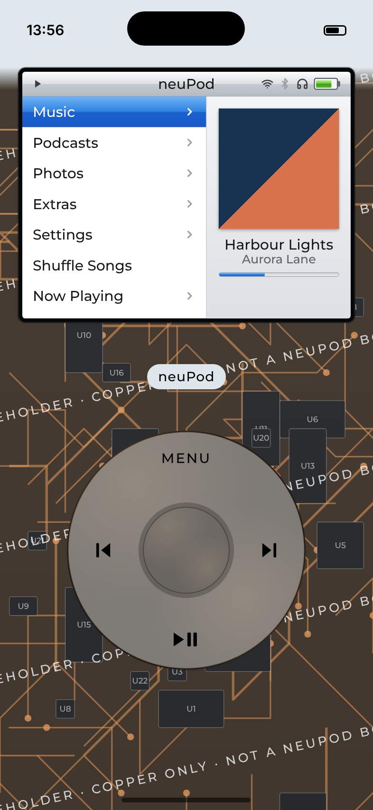 |

**Layers, bottom to top.**

1. The board's ground colour, over the whole phone.
2. The board picture, sharp, with its anchor on the wheel's centre (section 6).
3. The body's colour at the body's opacity.
4. The **cap**: the body's top colour, solid, from the phone's top edge to the screen frame's top edge, then fading
   to nothing over 0.06 W. The phone's status bar is always on a known colour.
5. The screen frame and screen, unchanged, plus a 1 px outer edge in the body's ink at 16 % so the frame reads on a
   dark or see-through body.
6. The wordmark; on its badge when the body is see-through. The badge is the body's colour, flat and solid, radius
   0.036 W, with 0.012 W of padding above and below and 0.03 W each side.
7. Inside the wheel's circle: the **blurred copy** of the board picture (same anchor and scale), then the wheel's
   colour at the wheel's opacity. The body's colour is not under the wheel.
8. Inside the centre button: the blurred copy again, then the centre's colour at its opacity.
9. Edges, legends, touch and press tints.

Layers 1, 2, 7 and 8 are drawn only when something needs them. A look with every part solid draws no picture and
costs what a finish costs today.

**What shows behind what.** Behind the body, the board sharp: this is the clear case. Behind the wheel and the centre
button, the board blurred, like frosted plastic: shapes and colour come through, detail does not. That keeps the
legends on a calm ground, makes the wheel read as a separate part even when it is the body's colour, and is why the
wheel can be see-through at all. The blur is made when the asset is built, never live.

**Most transparency.** Body **85 %**; wheel and centre **60 %**. Nothing reaches 100 %: a part with no colour of its
own has no edge to find and no tint to press, and "clear" plastic is never invisible. The wheel's lower limit keeps
the rule in section 4 from having to give much back.

**Gradients.** A part's one colour makes its gradient by mixing toward white (+) or black (-):

| Part | Top | Middle | Bottom |
| --- | --- | --- | --- |
| Body | +10 % at 0 | the colour at 45 % | -10 % at 100 % |
| Wheel ring | +6 % | | -6 % |
| Centre button | +6 % | | -6 % |

**Edges and states**, in the part's ink (black or white):

| | Solid part | See-through part |
| --- | --- | --- |
| Ring edge and centre edge, 1 px | ink at 30 % | the same |
| Groove round the centre, 0.04 R | ink at 22 % | the same |
| Finger on the ring, 50 degree wedge | black at 7 % or white at 8 % | plus 6 % x transparency: up to 10.6 % or 11.6 % |
| Button or centre pressed | black at 13 % or white at 14 % | plus 10 % x transparency: up to 19 % or 20 % |
| Disabled | legends at 35 % | the same |

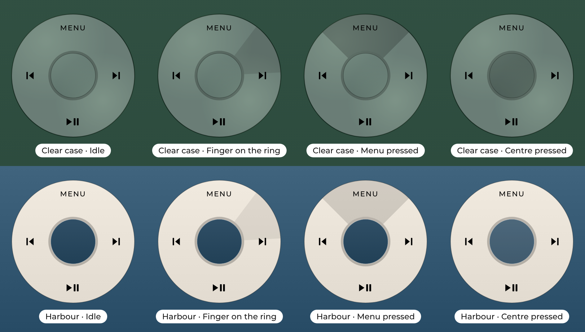

A tint over a busy ground reads weaker than the same tint over a flat one, so it strengthens with transparency.
Idle, the edge and the groove carry the wheel's shape; they are ink, not a shade of the part, so they survive any
colour and any transparency.

## 6. Board pictures

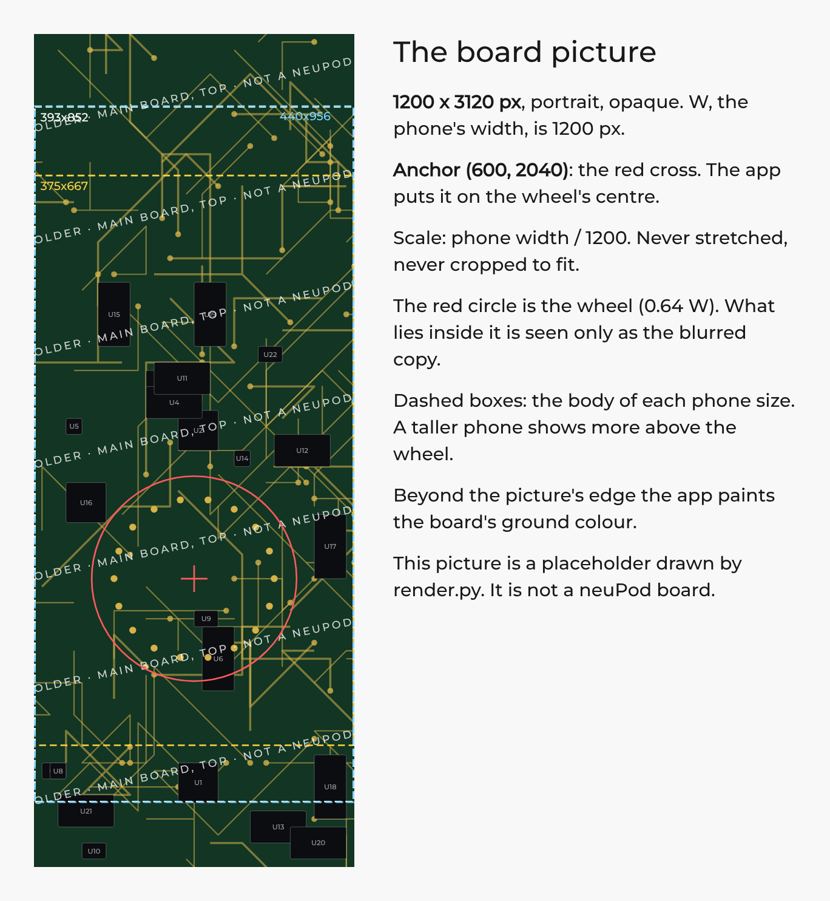

| | Value |
| --- | --- |
| Size | **1200 x 3120 px**, portrait, opaque, sRGB |
| Format | WebP, lossy at quality 85 or lossless if smaller; about 300 KB a picture is the aim |
| Scale | 1200 px is W, the phone's width. Drawn at phone width / 1200, never stretched and never cropped to fit |
| Anchor | pixel **(600, 2040)** sits on the wheel's centre. 1.70 W of picture above it, 0.90 W below |
| Beyond the edges | the board's ground colour, stored with the asset |
| Blurred copy | the same picture, Gaussian blur of radius 36 px (0.03 W), saved at 300 x 780 px and scaled up |
| Per board, stored | `id`, `name`, `ground`, and `frostDark` and `frostLight`: the darkest and lightest pixel of the blurred copy inside the largest wheel circle (radius 384 px about the anchor), measured when the asset is built |

**Alignment.** The picture hangs from the wheel, not from the top of the phone, because the wheel's centre is the
one point that moves with the phone's height. The board sits behind the wheel in the real device, so the picture
should have the wheel's connector, or whatever is truly there, at the anchor. A taller phone shows more picture
above and below; the screen covers most of what is above.

**Composing a picture.** Fill the whole canvas: the board at its true scale relative to the body where that is
known, on a plain backing in the board's ground colour. Keep the area inside radius 384 px of the anchor free of
large white silkscreen or bare bright metal, so the blurred copy stays within about 40 levels from darkest to
lightest; the app's asset test fails a picture whose spread makes a white, 60 % see-through wheel give back more
than 10 %.

**The set.** Three, as drawn: `Main board, top`, `Main board, bottom`, `Copper only` (the copper layers alone).
**Only neuPod's own boards may be used: KiCad renders or the owner's photographs of them.** No picture of any Apple
board, and none of the donor's. `boards/` in this repository is empty today, so there is nothing to render from yet:
the three pictures in the mock-ups are placeholders made by `render.py`, each lettered `PLACEHOLDER · NOT A NEUPOD
BOARD` across its face. The feature can be built and tested with them but must not be released with them (Open
question 2).

## 7. Presets

- **Six looks at most.** With `New look` that is seven rows, the screen's worth at the standard text size, so the
  list never scrolls (owner decision 2). Each is a few dozen bytes; the limit is the screen, not storage.
- **Where:** Settings > Custom look.
- **Save:** there is no Save. A look is stored as each change is made.
- **New look** makes a copy of the look in use (of the default finish when there is none), named `Look n` with the
  lowest unused number, opens it and makes it the look in use. That is also "save as". At six it is greyed with its
  reason at the right: `6 of 6`.
- **Name:** the Name row, typed with the device's text entry. Sixteen characters, the firmware's glyph set. An empty
  name is not accepted: Menu on an empty field leaves the old name.
- **Switch:** Select on a look in the list.
- **Delete:** Reset or delete > Delete look, then a centred panel `Delete Harbour?` with `Delete` and Menu to cancel,
  because something is about to be lost. Deleting the look in use makes the one above it the look in use. Deleting the
  last look leaves the list with only `New look`, and Mode falls back to Auto.
- **Reset to default:** Reset or delete > Reset to default, with the same kind of panel. It sets the look's three
  parts to the default finish for the look's screen as it stands (Light, or Auto on a light phone: the silver values
  below; otherwise the black ones), all solid. The name, the board and the screen choice are kept.

| Default | Body | Wheel | Centre |
| --- | --- | --- | --- |
| Light | 218, 4, 88 (`#d7dbe0`) | 220, 2, 95 (`#edeff2`) | 220, 4, 87 (`#d5d8de`) |
| Dark | 225, 20, 8 (`#101114`) | 223, 12, 14 (`#1f2124`) | 228, 19, 6 (`#0c0d0f`) |

| Default, Light | Default, Dark |
| --- | --- |
| 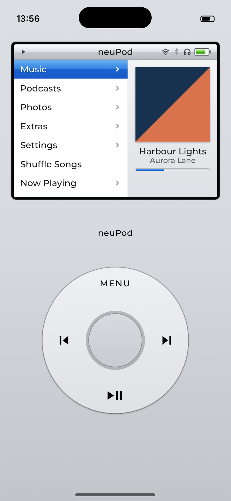 | 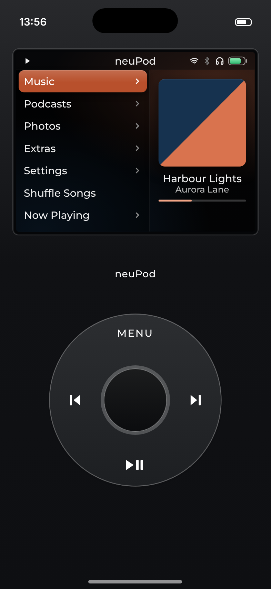 |

These are close to the silver and black finishes but are not them: Custom makes its gradients and its ink by its own
rules. Light and Dark modes keep the finish table exactly.

**The starter looks** (owner decision 3) are in the list on first use and are ordinary looks: they can be edited,
renamed and deleted, and are not restored.

| Look | Body | Wheel | Centre | Board | Screen |
| --- | --- | --- | --- | --- | --- |
| Harbour | 205, 62, 44, solid | 40, 8, 94, solid | 205, 62, 36, solid | Main board, top | Auto |
| Sea glass | 165, 35, 70, 55 % | 165, 10, 96, solid | 165, 40, 60, solid | Main board, top | Auto |
| Clear case | 200, 6, 92, 85 % | 200, 4, 96, 60 % | 200, 6, 90, 60 % | Copper only | Auto |

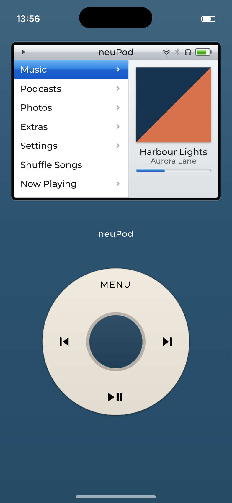

## 8. Accessibility

| Setting | What Custom does |
| --- | --- |
| **Reduce Transparency** (iOS; Android where the system offers one) | Every part paints solid; no board picture is loaded. The look is not changed. In the editor the Transparency field is greyed, with `Reduce Transparency is on` as the legend note while it has the focus |
| **Increase Contrast** (iOS; Android's high-contrast setting) | As Reduce Transparency, and: the legend target is 7:1. A part whose legend falls short has its **brightness moved the least distance**, darker or lighter, that reaches it (luminance at most 0.100 or at least 0.300 for a flat colour). Edges go from 30 % to 60 % ink. The look is not changed |
| **Reduce Motion** | No pulse when the part changes; previews in the lists swap without a fade |
| **Largest text** | The lists show fewer, larger rows, as every list does. The part editor keeps its structure and drops what it can say elsewhere (below) |

| Reduce Transparency, Clear case | Increase Contrast, Sea glass |
| --- | --- |
| 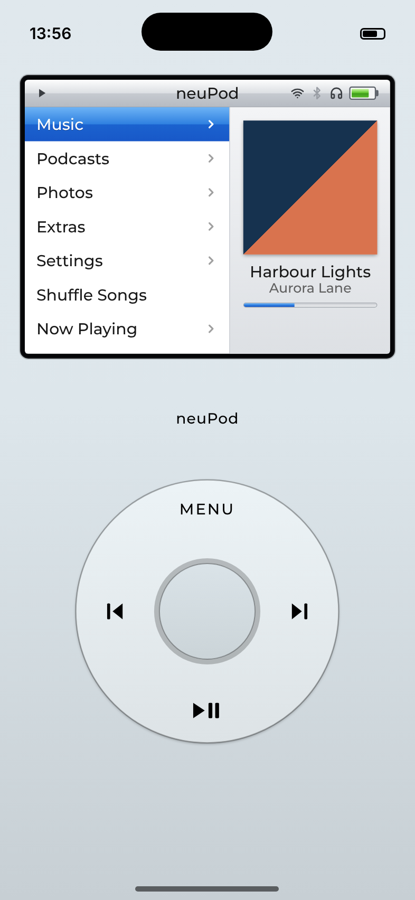 | 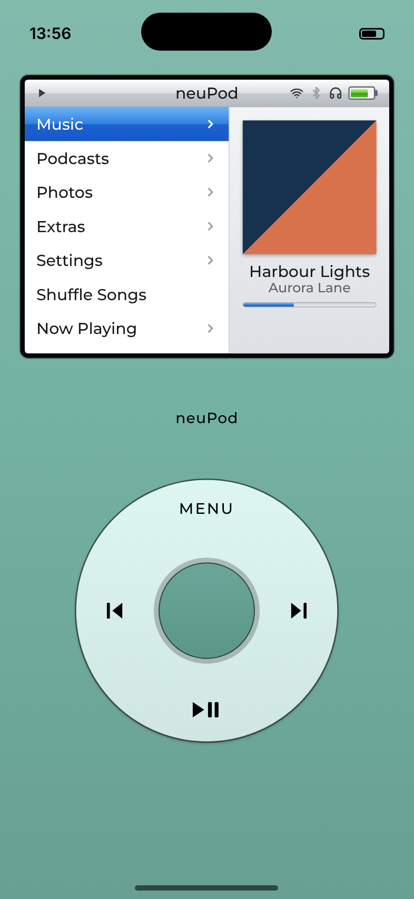 |

**The part editor at the text tiers.**

| Tier | k | Layout |
| --- | --- | --- |
| Standard | 1 | as section 2 |
| Large | 7/6 | the hint line goes; fields 66 high; colour wheel 230 |
| Largest | 7/5 | the part tabs go (the status-bar title already names the part, and Select still steps it); the right column shows **the focused field only**: its name at 31 px, its value at 53 px, its bar, and `1 of 4`; colour wheel 230; the legend note stays |

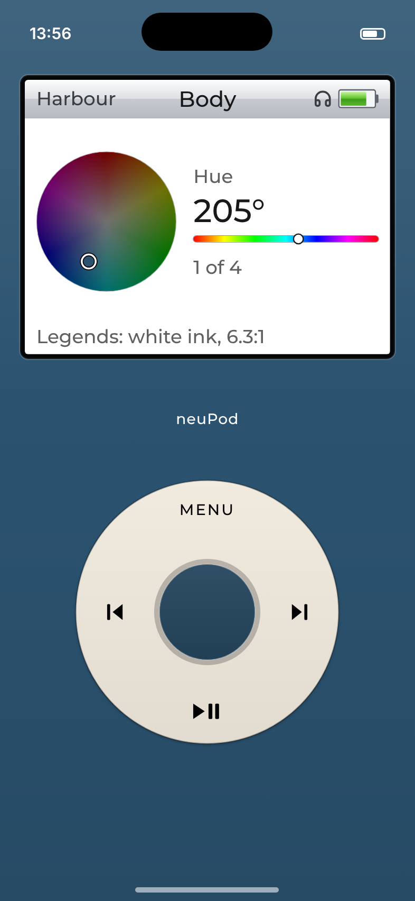

At the Large and Largest tiers the list of looks and a look's seven rows no longer fit and move with the wheel, as
all lists do there; no scroll bar is drawn on Custom's screens (Open question 5).

Screen reader: a look's row reads `Harbour, in use, 1 of 4`; a part row `Body, solid, 1 of 7`; the colour wheel is
one element, `Colour, hue 205 degrees, saturation 62 percent`, not adjustable (the click wheel is the adjustable
element). Nothing in the editor is told by colour alone: values are written beside every bar, and the swatch has its
hex beside it.

## 9. Classic and Modern

Custom changes the body, never the screen. The screen's style comes from the Style setting and its mode from the
look's Screen choice, so all four modes work with both styles. The screen always sits in its black glass frame,
which is what keeps a loud body off it.

| A pale body with Classic Light | A saturated body with Modern Dark |
| --- | --- |
| 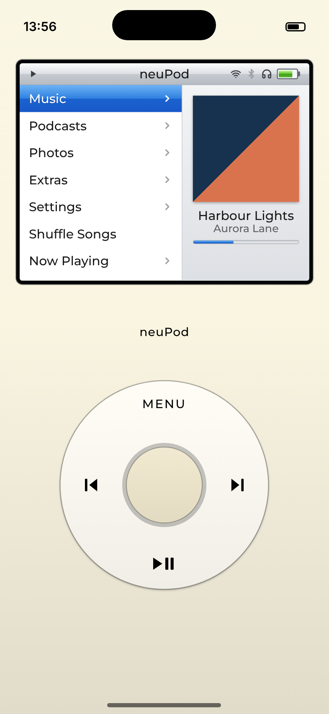 | 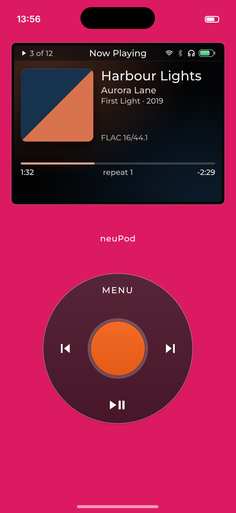 |

- **Pale body, Classic Light** (`Chalk`: 48, 10, 98). The white screen and the cream body are close in tone; the
  frame separates them as it does on silver. Ink is black at 15:1 or more on all three parts. The wheel differs from
  the body by a few levels only, so its shape rests on the 30 % edge and the drop shadow, as silver's does.
- **Saturated body, Modern Dark** (`Flare`: body 338, 88, 86; wheel 338, 70, 30; centre 20, 90, 95). Modern takes its
  accent and backdrop from the album art, so the body may clash with it; that is the user's choice and is left alone.
  The body's luminance is 0.167, just under the switch: ink is white, the gradient fails by a hair and the body is
  painted flat, for 4.85:1. The phone's status bar is light. This is the case the flat rule exists for.

Classic Dark and Modern Light are still not designed (UI styles Open question 1). Until they are, a look whose Screen
is Dark in Classic, or Light in Modern, shows the style's designed mode, exactly as Light and Dark modes do today.

## 10. The data model

In plain terms; names are suggestions.

**A part's paint**: four whole numbers.

| Field | Range | Meaning |
| --- | --- | --- |
| `hue` | 0 to 359 | degrees round the colour wheel, red at 0 |
| `saturation` | 0 to 100 | per cent, from the wheel's centre to its rim |
| `brightness` | 0 to 100 | per cent (the V of HSV) |
| `transparency` | 0 to 85 for the body, 0 to 60 for the wheel and centre | per cent see-through. Opacity is 100 less this |

The RGB colour is **computed** from the first three by the usual HSV conversion (`hsv()` in `render.py`) and never
stored. Storing what the user set means a grey keeps its hue and a black keeps its saturation when the editor is
opened again.

**A look.**

| Field | Type | Notes |
| --- | --- | --- |
| `id` | string | made once, never reused; the list's order is the stored order |
| `name` | string | 1 to 16 characters |
| `body`, `wheel`, `centre` | part paint | |
| `board` | `main-top`, `main-bottom` or `copper` | an unknown id falls back to `main-top` |
| `screen` | `light`, `dark` or `auto` | |

**The setting.**

| Field | Type | Notes |
| --- | --- | --- |
| `mode` | `light`, `dark`, `auto` or `custom` | replaces today's pinned-or-not mode |
| `looks` | list of looks, 0 to 6 | the three starters until the user changes them |
| `lookInUse` | a look's `id`, or none | kept when Mode leaves Custom |

Not stored: the ink, the flat flag, the transparency kept, the gradients. They are worked out from the look, the
board and the accessibility settings each time, so a changed rule or a new board picture never needs a migration.

```json
{
  "mode": "custom",
  "lookInUse": "look-2",
  "looks": [
    {
      "id": "look-2",
      "name": "Sea glass",
      "body": { "hue": 165, "saturation": 35, "brightness": 70, "transparency": 55 },
      "wheel": { "hue": 165, "saturation": 10, "brightness": 96, "transparency": 0 },
      "centre": { "hue": 165, "saturation": 40, "brightness": 60, "transparency": 0 },
      "board": "main-top",
      "screen": "auto"
    }
  ]
}
```

## Open questions

For the owner. Nothing here is settled by the drawings.

| # | Question | What was drawn meanwhile |
| --- | --- | --- |
| 1 | **The Custom look row.** Always shown under Mode (recommended), or only while Mode is Custom | Always shown |
| 2 | **The board pictures.** Which neuPod boards, rendered from KiCad or photographed, and by when. `boards/` is empty, so the feature cannot ship until there is at least one real picture. Is three the right number, and is `Copper only` wanted | Three placeholders, lettered as such |
| 3 | **The starter looks' colours.** Harbour, Sea glass and Clear case are agreed as a set; their exact values are the designer's | The values in section 7 |
| 4 | **Six looks.** The no-scroll rule gives six. More would mean a list that moves with the wheel | Six |
| 5 | **Largest text.** At the Large and Largest tiers the looks list and a look's seven rows cannot fit and move with the wheel, with no scroll bar drawn. Acceptable, or should those tiers split a look over two screens | Lists move with the wheel |
| 6 | **Settings is at seven rows** with Custom look added, before gapless, skip-back, reset statistics and About from the specification. To keep Settings from scrolling they need grouping (for example a Playback row and an About row) | Seven rows as drawn |
| 7 | **Most transparency**: 85 % for the body, 60 % for the wheel and centre. Judge on a phone with a real board picture | 85 and 60 |
| 8 | **The wordmark's badge** on a see-through body: a solid patch of the body's colour. The alternative is to leave the wordmark off a see-through body | Badge |
| 9 | **Android's status bar.** Its dark icons are the system's, and not always pure black, so a mid-tone body may fall a little under 4.5:1 there. Accept, or darken or lighten the cap on Android until the system's ink passes | Accepted |
| 10 | **Clashing with Modern.** A saturated body beside Modern's art-led accent is left alone. Should Modern offer to take its accent from the body instead | Left alone |
| 11 | **The device.** This is the phone app only. Does a real neuPod ever need to know the look (to show it in the companion, R3) | Not considered |
