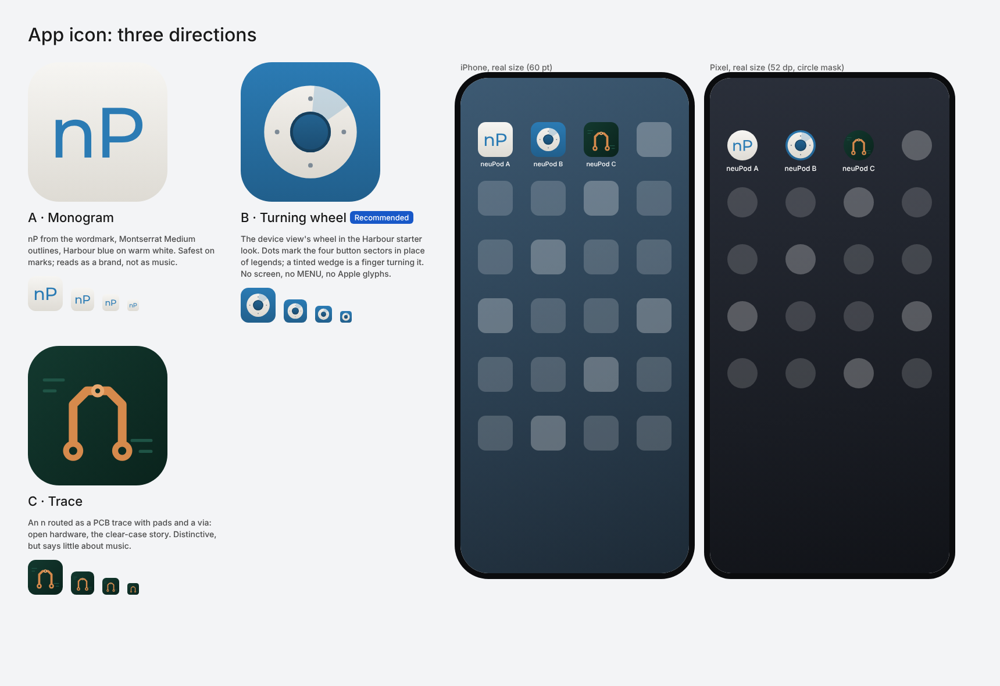
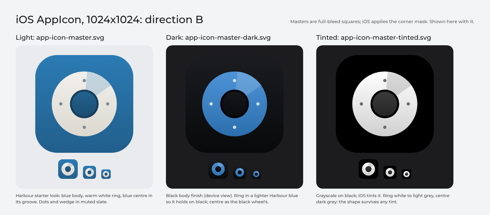
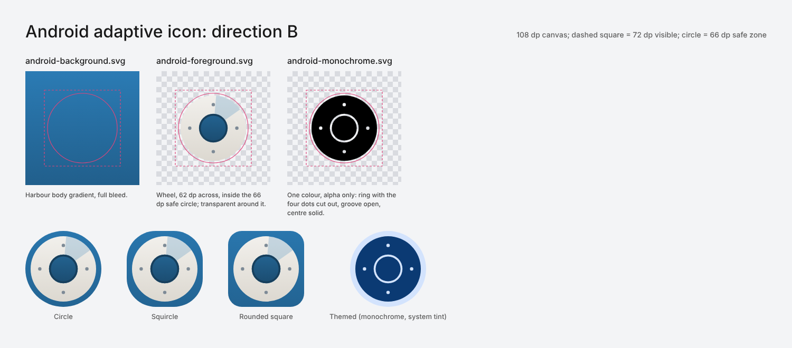
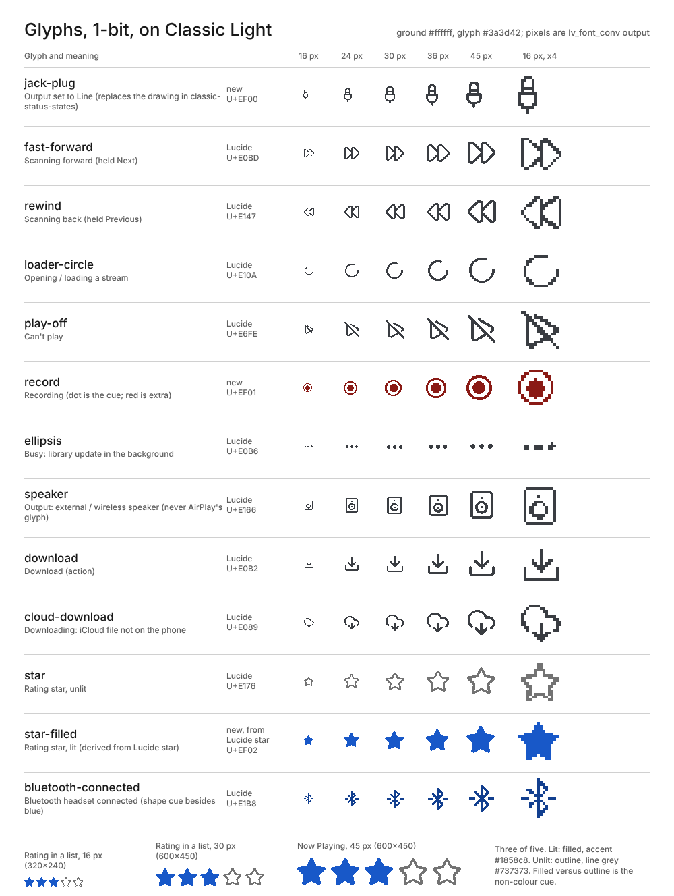
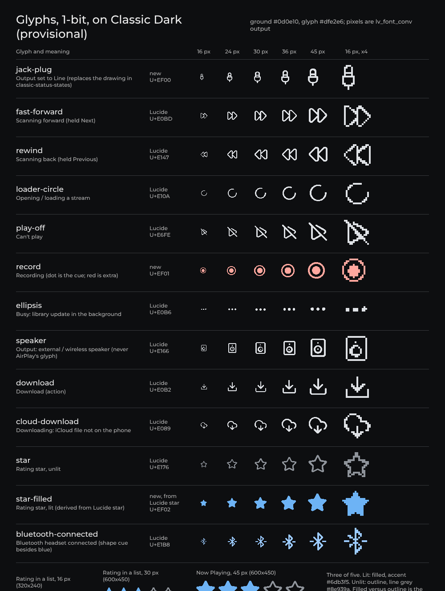
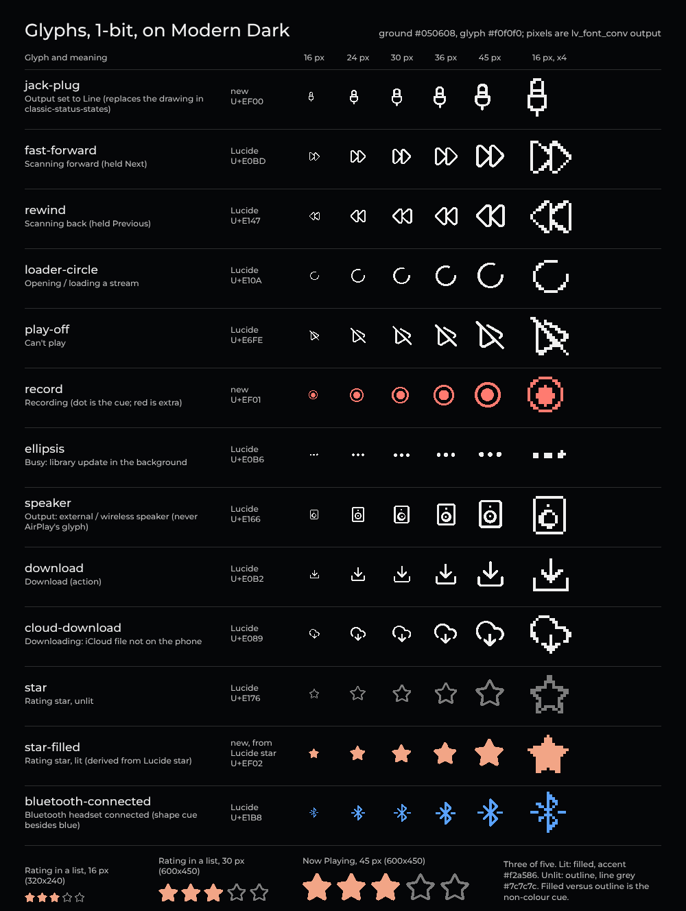
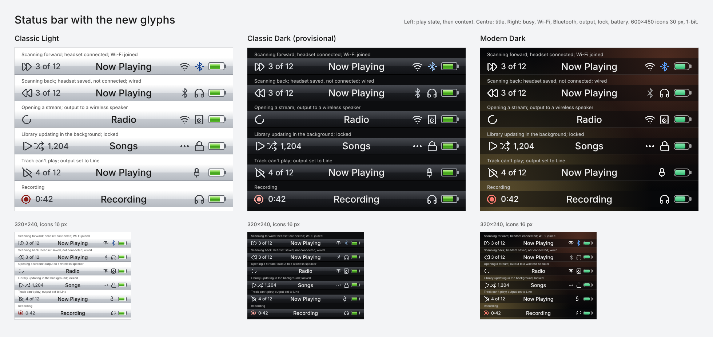

# Icon set: app icon and the missing UI glyphs, 26 November 2026

Backlog **AP-2** (the app icon) and the "Not yet drawn" list in the [UI styles](../2026-11-21-ui-styles/README.md),
plus the glyphs the phone app needs for ratings, downloads and external speakers. Works inside the UI styles, the
[device view](../2026-11-21-app-device-view/README.md), [Custom mode](../2026-11-25-app-custom-mode/README.md),
[ADR-0022](../../adr/0022-one-player-ui.md) and the constitution (I: one player UI; VI: no Apple marks or artwork).

This folder holds:

- this README: the decisions, the recommended app icon, open questions and the glyph table;
- [IMPLEMENTATION-BRIEF.md](IMPLEMENTATION-BRIEF.md): file names, sizes, code points and the build steps for engineers;
- [PROGRESS.md](PROGRESS.md): the checklist, ticked off as it merges;
- `svg/`: one SVG per glyph on Lucide's 24 px grid, and the app icon masters;
- `mockups/`: the sheets as standalone HTML and PNG;
- `render.py`: draws the sheets. It builds the new glyphs into a small font and rasterises **every** glyph with
  `lv_font_conv` 1.5.3 at 1 bpp, the tool and flags `tools/gen_ui_fonts.sh` already uses, so the 1-bit pixels on the
  sheets are the firmware's own bitmaps, not an approximation.

## The app icon (AP-2)

| Direction | What it is | For | Against |
| --- | --- | --- | --- |
| A · Monogram | `nP` from the wordmark, Montserrat Medium outlines, Harbour blue on warm white | No likeness risk at all; reads as a name | Says nothing about music; two letters get thin at 20 px |
| **B · Turning wheel (recommended)** | The device view's wheel in the **Harbour** starter look: blue body, warm white ring, blue centre in its groove; four dots mark the button sectors; a 50° wedge is the device view's touch tint, a finger mid-turn | Says "this is the player you hold", ties the icon to the device view and Custom mode, survives monochrome and tint as a pure shape | Any wheel invites the Apple comparison: see below |
| C · Trace | An `n` routed as a copper PCB trace with pads and a via, on solder-mask green | Open hardware, the clear-case story; nobody else's | Reads as electronics, not music |

**Decided: B** (owner, 26 November 2026). It is the one an owner recognises on a crowded home screen, and it is already neuPod's own drawing.
How it differs from Apple's click wheel and product artwork (constitution VI):

- no `MENU`, no transport legends: four plain dots mark the sectors of the device view's hit-zone geometry instead;
- the device view's proportions (centre 0.36 D, groove 0.44 R), not the 5G/6G's;
- no screen, no body outline, no device silhouette: just the wheel, so it is not a picture of a product;
- coloured in neuPod's Harbour look; the touch wedge is neuPod's own state from the device view;
- no Apple glyph, apple, `iPod` name or SF Symbol anywhere.

A and C are kept as masters for the record only.

### iOS and Android

- **iOS** (`svg/app-icon-master.svg`, `-dark`, `-tinted`): full-bleed 1024 squares, iOS applies the mask. Dark uses the
  black body finish with the ring in a lighter Harbour blue (`#4d93d6` to `#2c6fae`) so it holds on black. Tinted is
  grayscale on black: white ring, dark grey centre.
- **Android** (`svg/android-foreground.svg`, `-background`, `-monochrome`): 108 dp canvas; the wheel is 62 dp across,
  inside the 66 dp safe circle, so circle, squircle and rounded-square masks all keep it whole. Monochrome is one colour
  with the four dots cut out and the groove open, so the system tint keeps the wheel's structure.
- Directions A and C exist as single masters only (`svg/app-icon-direction-a-monogram.svg`, `-c-trace.svg`), enough to
  choose from. Variants are drawn for the chosen direction.

## The glyphs

| Glyph (`svg/`) | Base | Code point | Meaning | Where it shows |
| --- | --- | --- | --- | --- |
| `jack-plug` | **new** (redrawn on the Lucide grid from `classic-status-states.html`) | U+EF00 | Output set to Line | Status bar, output slot |
| `fast-forward` | Lucide `fast-forward` | U+E0BD | Scanning forward (Next held) | Status bar, play-state slot |
| `rewind` | Lucide `rewind` | U+E147 | Scanning back (Previous held) | Status bar, play-state slot |
| `loader-circle` | Lucide `loader-circle` | U+E10A | Opening / loading (network streaming) | Status bar, play-state slot |
| `play-off` | Lucide `play-off` | U+E6FE | Can't play | Status bar, play-state slot; greyed row with its reason |
| `record` | **new** | U+EF01 | Recording | Status bar, play-state slot |
| `ellipsis` | Lucide `ellipsis` | U+E0B6 | Busy: library update in the background | Status bar, right zone, first |
| `speaker` | Lucide `speaker` | U+E166 | Output is an external speaker (Wi-Fi, AirPlay or other) | Status bar, output slot; output pickers |
| `download` | Lucide `download` | U+E0B2 | Download (an action) | App rows and menus |
| `cloud-download` | Lucide `cloud-download` | U+E089 | Downloading: an iCloud file not yet on the phone; the reason is on the row | App rows |
| `star` | Lucide `star` | U+E176 | Rating, unlit | Lists, Now Playing page 2 |
| `star-filled` | **new**, derived from Lucide `star` | U+EF02 | Rating, lit | Lists, Now Playing page 2 |
| `bluetooth-connected` | Lucide `bluetooth-connected` | U+E1B8 | Headset connected or in use | Status bar, Bluetooth slot |

Lucide code points are the Lucide font's own (1.72.0, as pinned in `tools/gen_ui_fonts.sh`). The three new glyphs take
U+EF00 to U+EF02, a private-use block above Lucide's highest (U+E853) and below the Font Awesome symbols (U+F001 up).

### Decisions

1. **Lucide wherever Lucide has it.** Nine of the thirteen are unmodified Lucide glyphs: they come through the existing
   pipeline with only new code points. Only the plug, the record mark and the lit star are drawn.
2. **The jack plug is redrawn on the grid**, 2 px stroke, round caps and joins: a 6-unit tip with one insulating ring,
   a 10-unit body with rounded bottom, a 3-unit cable. It keeps the drawing's meaning and its upright stance, and stays
   distinct from Lucide `plug` (a mains plug with two prongs). At 16 px the tip closes to a solid pin and still reads.
3. **Fills only for "on".** The rule allows fills only where the UI styles already use them. Two glyphs mean *lit*, and
   the fill is their non-colour cue: the lit star (filled versus outline) and the record mark (a solid dot in a ring;
   the dot is the universal sign, red is extra). Nothing else is filled.
4. **Ratings in the device's way**: lit in the style's accent (`#1858c8` Classic Light; `#6db3f5` Classic Dark; the
   art's light tint, `#f2a586` in the mock-up, on Modern), unlit in line grey. Filled versus outline carries the
   meaning without colour. List size is the icon font's small size (16 / 24 / 30 px by profile), Now Playing the large
   (24 / 36 / 45). This replaces the Font Awesome star (`UI_SYMBOL_STAR`) so ratings match the rest of the icons.
5. **Bluetooth gets a shape cue** (Gate 2, owner decision 13): connected or in use is `bluetooth-connected` (the glyph
   with a tick each side) **and** blue; saved but not connected is plain `bluetooth` in the dim colour. The app already
   ships `bluetooth-connected.svg`; this brings the firmware into line.
6. **Busy dots sit first in the right zone**, before Wi-Fi: a background job is device state, like the radios, and the
   left zone belongs to playback. The firmware keeps drawing them as three shapes that light in turn (ui_icons.h says
   so); the `ellipsis` glyph is for the app and for static places. Lucide's dots land unevenly at 16 px (see the x4
   cell), which is why the drawn shapes stay.
7. **External speaker is Lucide `speaker`**, never AirPlay's glyph (owner decision 13), for every wireless or network
   output that is not a Bluetooth headset.
8. **Opening uses `loader-circle`** as a static glyph. It may turn in 45° steps on hosted builds; on the
   microcontroller it stays still.
9. **Contrast.** Every glyph colour meets 4.5:1 against the worst point under it (for the status bar, its darkest or
   lightest gradient stop; for Modern, the bar over a bright art backdrop). This moved three Classic Light values from
   the 21 November table, as Gate 2 asked:

| Style | Role | Colour | Worst ground | Ratio |
| --- | --- | --- | --- | --- |
| Classic Light | glyph | `#3a3d42` | bar `#b6bbc2` | 5.65 |
| Classic Light | dim (was `#9a9ea5`) | `#474b52` | bar `#b6bbc2` | 4.54 |
| Classic Light | Bluetooth active (was `#1858c8`) | `#123f8f` | bar `#b6bbc2` | 5.10 |
| Classic Light | recording | `#8a1a15` | bar `#b6bbc2` | 4.86 |
| Classic Light | star lit / unlit | `#1858c8` / `#737373` | `#ffffff` | 6.42 / 4.74 |
| Classic Dark* | glyph / dim | `#dfe2e6` / `#b5bac1` | bar `#45484e` | 7.06 / 4.70 |
| Classic Dark* | Bluetooth active / recording | `#9ccbff` / `#ffa79e` | bar `#45484e` | 5.41 / 4.92 |
| Classic Dark* | star lit / unlit | `#6db3f5` / `#8e939a` | `#0d0e10` | 8.66 / 6.24 |
| Modern Dark | glyph / dim (was `#7a7a7a`) | `#f0f0f0` / `#9a9a9a` | bar over a gold wash `#2f2a1f` | 12.5 / 5.07 |
| Modern Dark | Bluetooth active / recording | `#5aa2ff` / `#ff7b70` | `#2f2a1f` | 5.47 / 5.65 |
| Modern Dark | star lit / unlit | `#f2a586` / `#7c7c7c` | `#050608` | 10.1 / 4.86 |

\* **Classic Dark is still not designed** (UI styles open question 1). Its colours here are provisional, chosen only so
the glyphs could be checked on a dark Classic ground. They are not a design for Classic Dark.

With the dim colour this dark, saved and connected Bluetooth are told apart by shape, not by shade, which is why
decision 5 matters.

## The status bar

Six states, in all three styles, at 600x450 (icons 30 px) and 320x240 (16 px), every glyph 1-bit from the real font:
scanning forward with a headset connected; scanning back with a saved headset and wired headphones; opening a stream to
a wireless speaker; a library update while locked; a track that can't play with Line out; recording. The right zone
order is: busy, Wi-Fi, Bluetooth, output (headphones, jack plug or speaker), lock, battery.

## Open questions

Questions 2 to 5 were settled on the recommendations below (owner, 27 November 2026).

| # | Question | Recommendation |
| --- | --- | --- |
| 1 | ~~App icon direction~~ | **Decided 26 Nov 2026: B, Turning wheel** |
| 2 | ~~**Transport glyph fills.**~~ **Decided 27 Nov 2026: outline everywhere.** The 21 November mock-ups draw play and pause filled; the firmware draws Lucide's outlines. The new scanning, can't-play and opening glyphs follow the outlines | **Outline everywhere**, the firmware as reference (ADR-0022); redraw the mock-ups' play and pause when they are next touched |
| 3 | ~~**Busy dots' place**~~ **Decided 27 Nov 2026: right zone.**: first in the right zone (drawn) or after the play glyph on the left | **Right zone**, decision 6 |
| 4 | ~~**Classic Light dim and Bluetooth colours**~~ **Decided 27 Nov 2026: adopted.** change for 4.5:1 (table above) | **Adopt**, together with `bluetooth-connected` as the shape cue |
| 5 | ~~**Classic Dark**~~ **Decided 27 Nov 2026: test ground only.** was needed as a ground to test on and is still undesigned | Treat the provisional colours as a test ground only; check these glyphs again when Classic Dark is designed |

## Licences

Everything drawn here is the project's own: the sheets and this text CC BY 4.0, the SVGs and the app icon alongside the
firmware under MPL-2.0. Nine glyphs are unmodified Lucide icons and `star-filled` is derived from Lucide `star`: all ten
are **ISC** (Lucide 1.72.0), and none of them derives from Feather. Add them to the Lucide row of `LICENSE.md` (now
"the 15 icons of the design system and the 5 of the boot splash" plus these 10) and to the Licences screen
(`app/ui/ui_licence_data.c`), which `tests/test_licences.c` checks. `jack-plug`, `record` and the app icon are entirely
neuPod's; direction A's letters are Montserrat Medium outlines (SIL OFL 1.1, already in the table).
