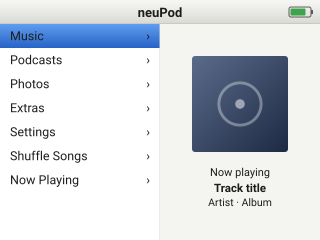
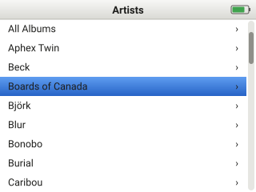
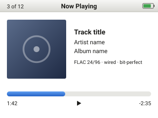
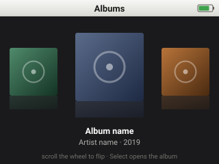
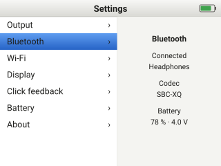

# UI mock-ups

Target: the Phase 1 panel, **320×240 landscape**. Each screen is an original drawing at the
panel's native size (SVG, `viewBox="0 0 320 240"`); the look follows the classic click-wheel
player layout — split menu with artwork, blue selection bar — lightly modernised. These are
design intent, not screenshots of any existing firmware.

Click-wheel vocabulary used below: **Menu** (top button, goes back), **Select** (centre),
**Play/Pause** (bottom), **Left** / **Right** (previous / next), **scroll** (finger on the ring).

## Main menu

- Scroll moves the selection bar through Music, Podcasts, Photos, Extras, Settings, Shuffle
  Songs, Now Playing. Scroll acceleration follows the Rockbox constants (4 counts per step,
  velocity-based acceleration).
- **Select** opens the highlighted item. **Menu** does nothing at the top level.
- **Play/Pause** toggles playback without leaving the menu; the right pane shows the current
  track's artwork and title, or a clock when nothing is playing.
- **Left** / **Right** skip tracks in the background.

## Library — artists

- Full-width list; scroll bar on the right shows position in long lists. Fast scrolling shows a
  letter overlay (not drawn) so a 100k-track library is navigable.
- **Select** descends (artist → albums → tracks); **Menu** ascends one level.
- **Right** on an artist jumps to All Albums for that artist; **Left** returns to the previous
  level without animation.
- The same template serves Albums, Songs, Genres, Composers, Playlists and Podcasts.

## Now playing

- Shows artwork, title, artist, album, the format badge (e.g. FLAC 24/96, wired, bit-perfect)
  and the progress bar with elapsed and remaining time.
- Scroll adjusts **volume** by default; a first **Select** switches the scroll to **seek** (bar
  highlights), a second Select returns to volume. Pressing Select again shows rating / shuffle /
  repeat options (not drawn).
- **Play/Pause** toggles; **Left** / **Right** previous / next track (hold Right to fast-forward).
- **Menu** returns to the list the track was chosen from.
- On Bluetooth output the badge reads the negotiated codec (e.g. SBC-XQ, AAC).

## Album browser

- Dark full-screen carousel of album artwork; the centre album is enlarged with a reflection.
- Scroll flips through albums with acceleration; **Select** opens the centre album's track
  list; **Menu** returns to the library.
- This view is the one place the UI uses the panel's colour depth heavily; on the AMOLED
  candidate the black background also saves power.

## Settings

- Two-pane: list of settings groups on the left, a live detail pane on the right for the
  highlighted group (shown: Bluetooth — connected device, codec, battery).
- **Select** enters a group; inside, scroll changes the value and Select confirms.
- "Click feedback" is where the piezo / haptic / off choice lives, pending the hardware decision
  in [Requirements → Reused parts and mechanical](requirements.md#reused-parts-and-mechanical).
- "Output" chooses headphone / line / optical / USB when the jack detect cannot decide.

## Implemented (stage 2: home menu)

Firmware screens in `app/ui/` (LVGL, light theme as in the mock-ups above; all drawing is original). Rendering
is partial (two 320x24 strip buffers); the list scrolls with one short animation, everything else is static.
Nothing persists across a reboot yet (settings are RAM only).

**Common frame.** A status bar on every screen: title in the middle, battery icon and percentage on the right
("--" when the gauge failed its check; green with a charge symbol while charging, red at 15 % or less), and a
play/pause glyph slot on the left (empty: nothing plays yet). **Menu** goes back one screen (nothing at the top
level), **Select** enters. Lists clamp at both ends (no wrap), the selection bar jumps and the list scrolls
smoothly when the selection leaves the window; a thin scroll bar shows on long lists.

**Scrolling.** The wheel reports counts; 4 counts make one list step, and fast movement multiplies it (2x, 4x, 8x
when many counts arrive within 150 ms; the constants `UI_COUNTS_PER_STEP`, `UI_ACCEL_*` are in
`app/include/runtime_config.h`). Each testbed key press is exactly one step.

| Screen | What it does now |
| --- | --- |
| Home | Left list: Music, Podcasts, Photos, Extras, Settings, Shuffle Songs, Now Playing. Right pane: nothing is playing, so the artwork placeholder, `Nothing playing`, the uptime since boot (there is no clock, none is faked) and a card summary (type and size, or `No card`). |
| Music | Artists, Albums, Songs, Genres, Playlists; each opens an `Empty - no library yet` list. |
| Podcasts, Photos, Shuffle Songs | Placeholder screens saying what is missing. |
| Now Playing | Live: title, artist and album with track number from the file's tags (the file name if there is no title), a format badge such as `FLAC 24/96`, `MP3 320k` or `ALAC 16/44.1`, `Playing` / `Paused` / `Finished` or the error, elapsed and remaining time with a progress bar, and the volume with a level bar. **The wheel is the volume** (2 dB per step, starts at -30 dB); **Play** (or Select) pauses and resumes; **Menu goes back while the sound continues**. Without anything playing it says `Nothing playing`. Play/Pause works on every screen. |
| Extras | Files, Test tone. |
| Extras, Test tone | Three rows, each `On` / `Off`: **1 kHz tone**, **L/R ident** (1 s left, then 1 s right) and **Scale** (C4 up to C5 and back, looping). Select starts or stops the highlighted one (starting one stops the other); **Left / Right = volume**; the screen shows the volume and the level reaching the DAC. Leaving the screen stops the sound. See [Audio](audio.md). |
| Extras, Files | **Read-only** browser of the card: folders first then files, alphabetical, hidden entries (starting with a dot) skipped, size on the right, a chevron on folders. Select opens a folder, Menu goes up (at the root it leaves). **Select on a `.wav`, `.flac`, `.mp3` or `.m4a` (ALAC) plays it** and opens Now Playing; **Right on a `.flac` verifies its MD5 without sound** (see [Audio](audio.md)). Other files show `Not a playable file` for 3 s; an AAC `.m4a` opens Now Playing with `AAC not supported yet`. At most 256 entries per folder are kept (`... more (first 256 shown)` row after them); names longer than 63 bytes are cut at a character boundary. Directory reads run in the storage task, so the screen shows `Loading...` and keeps responding; without a working card it says why (`Storage unavailable: no card`). |
| Settings | Two panes (groups left, live summary right). **About**: version, build hash, platform, uptime, heap free, audio blocks / underruns / jitter, core 1 stack, and the result of every boot check. **Display**: Select, then scroll adjusts the backlight in 5 % steps (never below 5 %); RAM only. **Click feedback**: Select toggles On/Off (default On; needs the haptic driver). **Bluetooth**: not available yet. **Storage**: card type, size, filesystem, mode, free space (computed by the storage task, `computing...` until done). **Battery**: voltage, charge, rate, state, alerts, gauge status; live, once a second. |

**Click feedback.** Every list step asks the haptic task for a click (ROM effect 3, a gentle click). The request is
a non-blocking queue write: the UI never waits on the I2C bus, requests closer than 35 ms are dropped, and the
driver goes back to standby after 2 s without a click or at any error.

**Keys.** UART testbed: `w`/`k` up, `s`/`j` down, Enter or `e` Select, `m` or Backspace Menu, `a` Left, `d` Right,
`p` or Space Play/Pause. Host window: Up/Down arrows and mouse wheel scroll, Enter Select, Esc/Backspace/`m` Menu,
Left/Right, Space/`p` Play/Pause. The wheel, when it works, sends the same events.

**Host tour.** `neupod --tour --snapshots DIR` walks through the screens by script and writes `home`, `music-menu`,
`music-empty`, `extras`, `files`, `files-sub`, `files-many`, `files-many-end`, `settings`, `about`, `nowplaying`
(PPM) into `DIR`; `ctest` runs it as `runtime_smoke` against a small fixture card (`build/host/fsroot_fixture`,
`NEUPOD_FS_ROOT`) and writes `build/host/snapshots/`.

## Not yet drawn

- Hold-switch lock overlay, charging screen, USB mass-storage ("Connected") screen.
- Podcasts and Photos browsers; the search screen.
- Letter overlay during fast scroll; rating / shuffle / repeat sub-screens.
